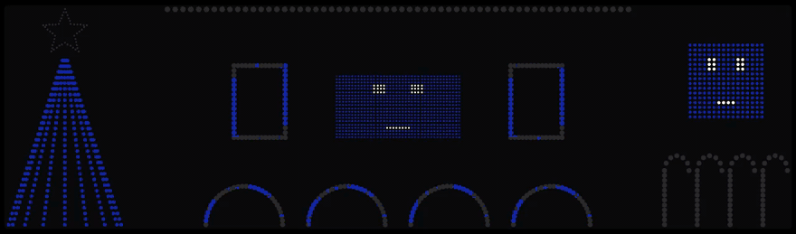
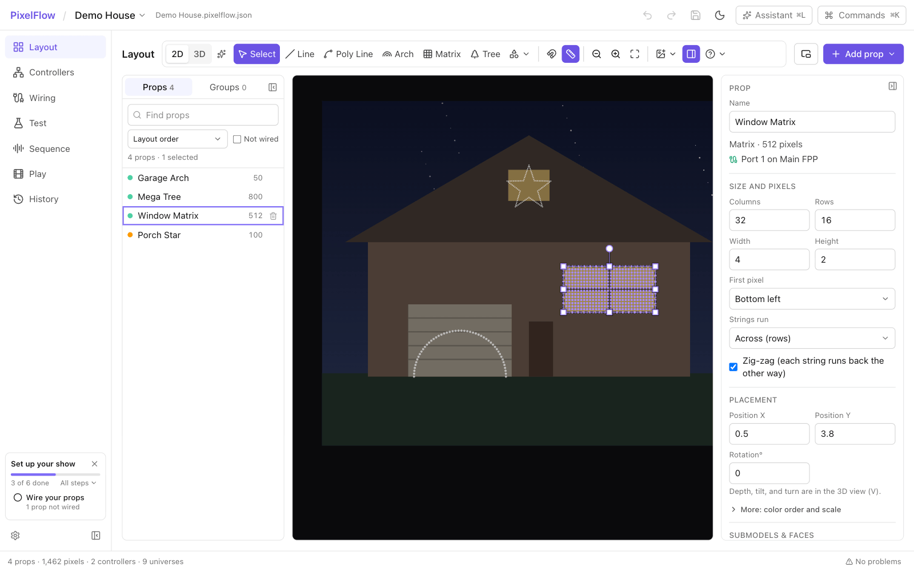
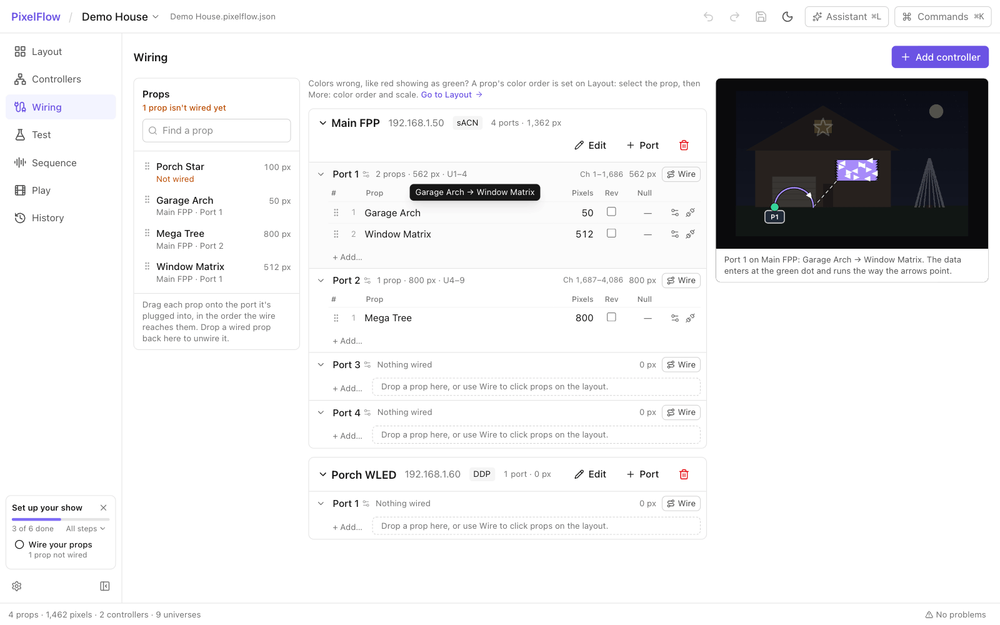
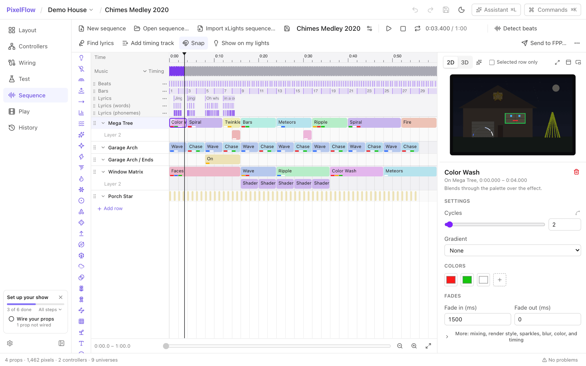
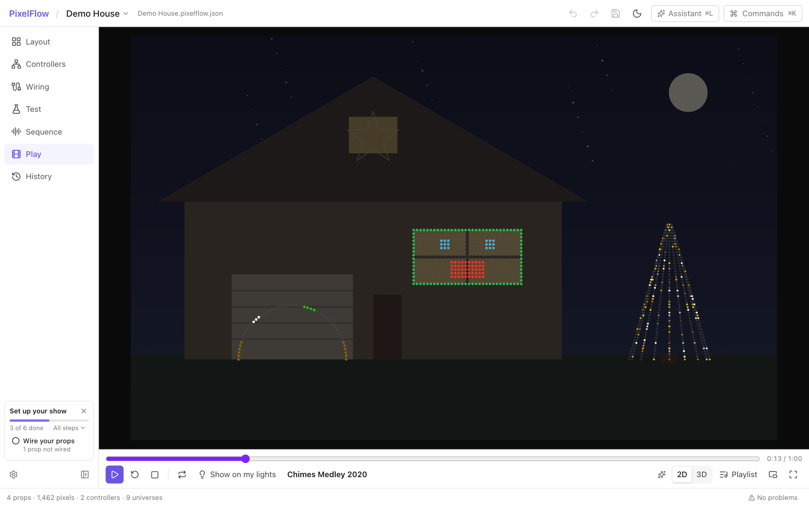
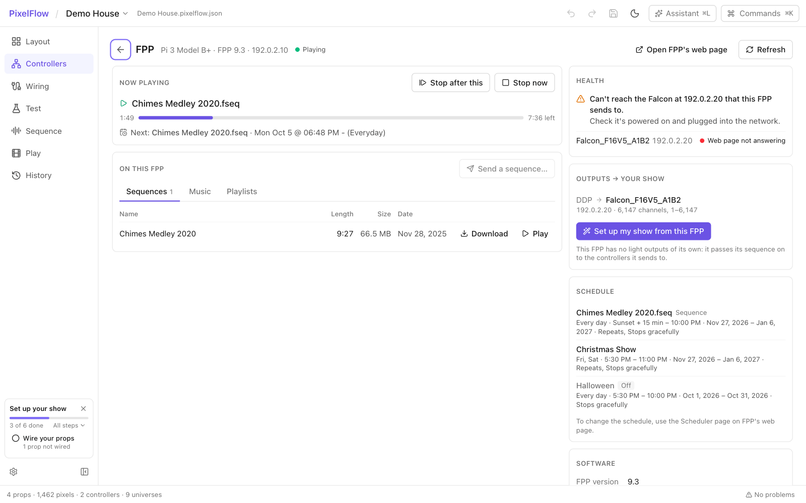
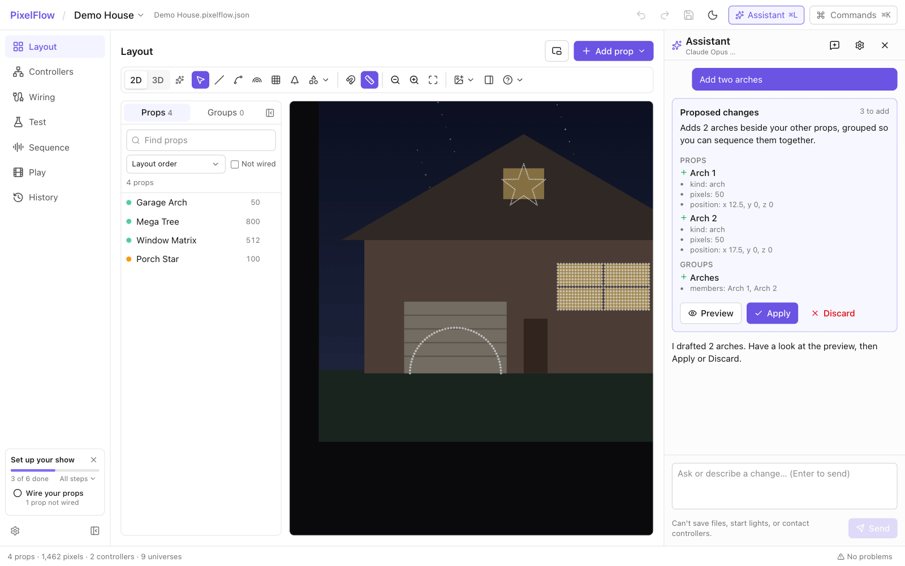

# PixelFlow

A modern, fast, easy-to-use application for designing and running pixel light displays: lay out
your props, wire them to your controllers, sequence them to music, and play the show. PixelFlow
is free and open source. It is an independent project inspired by
[xLights](https://github.com/xLightsSequencer/xLights), and it can import xLights shows and
sequences.

> **Status:** early development, with no released version yet. To try it you build it from
> source ([Install](#install)). Expect rough edges, and keep a copy of any show you care about.



*A made-up display playing a sequence, drawn frame by frame by PixelFlow's own engine (the same
drawing a video export makes).*

## What it does

- **Layout:** place props in 2D or 3D, group them, and see them lit in a live preview.
- **Controllers and wiring:** find FPP, Falcon, and WLED controllers on your network, read their
  setup, and wire props to ports by dragging. Channels and universes are worked out for you.
- **Test:** send test patterns to a prop, a port, a controller, or the whole show over sACN or
  DDP.
- **Sequence:** a timeline with effects, beat and section detection from the music, lyric timing,
  and singing faces.
- **Play:** play a sequence on screen and on your lights, send it to an FPP for unattended
  playback, or export a video. The first video export asks to download Cisco's OpenH264 encoder
  from Cisco (PixelFlow doesn't come with one: Cisco pays the H.264 patent licence for the
  copies it hands out itself), or uses your own ffmpeg.
- **xLights import:** bring in a show folder and its sequences, and map a vendor's sequence onto
  your own props.
- **Assistant:** bring your own Anthropic or OpenAI key and ask for changes to layouts and
  sequences in plain language. Nothing changes until you apply it.

| Layout | Wiring |
|---|---|
|  |  |
| **Sequence** | **Play** |
|  |  |
| **Controllers** | **Assistant** |
|  |  |

The app's screens above are from the browser demo (`?demo`, see [Run the desktop app](#run-the-desktop-app)),
which draws effects only roughly; the picture at the top is the engine's.

What it aims for:

- **Easy to use:** guided setup, drag-and-drop wiring, plain-language errors, undo everywhere.
- **Built for scale:** 200k+ pixels and 1,200+ universes at 40 fps.
- **No manual channel math:** channels and universes are assigned automatically from your wiring.

## Install

There are no downloads yet. Installers for macOS and Windows will be on the project's
[Releases](https://github.com/bradh11/pixelflow/releases) page when the first version is
published. Until then, build it from source.

### What you need

On every system: [Rust](https://rustup.rs) (the version is pinned in `rust-toolchain.toml`, and
rustup installs it for you), [Node.js](https://nodejs.org) 22 or newer, [pnpm](https://pnpm.io),
and a C and C++ compiler. Some dependencies build C code, and the engine's tests and developer
tools build an H.264 encoder from source so they work offline. The app itself has none built in:
the first video export downloads Cisco's (see [Your data](docs/privacy-and-data-flow.md)).

| System | Also needed |
|---|---|
| **macOS** | Xcode's command line tools: `xcode-select --install`. |
| **Windows** | Microsoft's C++ Build Tools (the "Desktop development with C++" workload). WebView2 comes with Windows 11; on Windows 10, install Microsoft's WebView2 runtime. |
| **Linux** | The libraries Tauri needs (WebKitGTK 4.1 and GTK 3) and ALSA's headers. On Debian or Ubuntu: `sudo apt install build-essential pkg-config libwebkit2gtk-4.1-dev libgtk-3-dev libayatana-appindicator3-dev librsvg2-dev libssl-dev libxdo-dev libasound2-dev`. |

macOS and Windows are built and tested on every change. The engine is tested on Linux too, but
the desktop app is not yet built or tried there: it should build, and reports of how it goes are
welcome.

### Build and run

```sh
git clone https://github.com/bradh11/pixelflow.git
cd pixelflow
make setup   # install the app's dependencies (once)
make run     # run the desktop app with live reload
make build   # or build an installable app (in app/src-tauri/target/release/bundle)
```

Without `make` (on Windows, say): `cd app`, then `pnpm install`, then `pnpm tauri dev` or
`pnpm tauri build`.

To look around without any hardware, choose **Try the demo show** on the welcome screen.
[Your first show](docs/first-show.md) takes it from there.

## Documentation

- [Your first show](docs/first-show.md): from an empty show, or an xLights show, to lights playing music.
- [Troubleshooting](docs/troubleshooting.md): nothing lights, wrong colors, controllers not found, Send to FPP problems, and more.
- [Real-hardware acceptance checklist](docs/hardware-acceptance.md): a checklist to fill in against real controllers.
- [xLights import fidelity](docs/fidelity.md): how an imported sequence looks next to xLights, and how that is measured.
- [Shaders](docs/shaders.md): the Shader effect, shader files, where they live, what runs, and its limits.
- [DMX floods, pars, bars, moving heads, and servos](docs/dmx.md): DMX fixtures, addressing, sACN, Art-Net and USB DMX, and safety.
- [Scale benchmark](docs/benchmarks.md): how large a show the engine can run.
- [Your data: what stays on your computer](docs/privacy-and-data-flow.md): what PixelFlow sends, and when.
- [Releasing](docs/releasing.md): building the macOS and Windows installers, signing, installing a test build, and where the app keeps its data.
- [Security](SECURITY.md) and the [threat model](docs/security/threat-model.md): how to report a vulnerability, and how PixelFlow is meant to protect you.
- [Licensing](docs/licensing/): what is derived from other projects, the licences of everything PixelFlow is built from, and what distributing it involves.
- For contributors: [CONTRIBUTING.md](CONTRIBUTING.md), and the notes in [docs/dev/](docs/dev/).

## Stack

- **Engine:** Rust (headless, real-time output)
- **Desktop shell:** Tauri 2
- **UI:** React + TypeScript + Vite, three.js (WebGPU) preview

## Development

Common tasks have `make` shortcuts — run `make` to list them. The most useful:

```sh
make setup   # install the app's dependencies (once)
make run     # run the desktop app with live reload
make test    # run every test
make lint    # formatting and lint checks (same as CI)
make build   # build an installable app
```

Requires [Rust](https://rustup.rs). The toolchain version is pinned in `rust-toolchain.toml`, and rustup installs it automatically.

```sh
cargo test --workspace                                   # run all tests
cargo clippy --workspace --all-targets -- -D warnings    # lint
cargo fmt --all                                          # format

# Try the CLI on the demo show
cargo run -p pf-cli -- validate examples/shows/demo.pixelflow.json
cargo run -p pf-cli -- map examples/shows/demo.pixelflow.json
```

### Send a test pattern to real controllers

`test-pattern` sends live sACN/DDP output to the controllers in a show file, so point it at
your own show (the demo show's addresses are examples):

```sh
cargo run -p pf-cli -- test-pattern my-show.pixelflow.json --pattern chase --target "prop:Mega Tree"
cargo run -p pf-cli -- test-pattern my-show.pixelflow.json --pattern identify --target "port:Main FPP:2" --seconds 30
```

Patterns: `solid`, `cycle`, `chase`, `ramp`, `alternate`, `identify`, `walk`. Targets: `show`,
`prop:NAME`, `group:NAME`, `controller:NAME`, `port:CONTROLLER:NUMBER`. Use `--bind <local IP>`
to choose the network interface. Output stops with a blackout frame when the run ends.

### Find your controllers

PixelFlow finds FPP, Falcon, and WLED controllers on your network and reads their pixel
setup so you can add them to a show. Finding and reading change nothing on a controller. The
app only writes to one when you choose **Send setup to this controller…** (FPP and WLED; Falcon
controllers are read-only), and it shows what will change first.

```sh
make discover                                    # or: cargo run -p pf-cli -- discover
cargo run -p pf-cli -- discover --host 10.0.0.50  # also check an address directly
cargo run -p pf-cli -- device 10.0.0.50           # one controller's setup and what importing adds
```

In the app, use **Find controllers** on the welcome screen or on the **Controllers** screen.

Discovery listens for FPP's MultiSync ping and mDNS, checks the web page of every address on
the /24 around each of your private network addresses, and asks each FPP which controllers it sends to. If a firewall
blocks the replies (macOS does for unsigned command-line tools), the network check and FPP's
list usually still find your controllers; a controller an FPP lists that doesn't answer is reported so you
can check its power and network cable.

### Play a sequence

**Play** is the show-time view: your lights filling the window while a sequence plays, with a
transport under them (play, pause, back to the start, stop, a seek bar, 2D or 3D, and glow).

- **What you're working on plays there.** A sequence open on the **Sequence** screen shows on
  Play ready to go. It's the same playback as the Sequence screen's, so play, pause, and the
  position stay in step between the two. **Show on my lights** (the same toggle on Sequence)
  sends it to your controllers as it plays; off, it plays only on screen.
- **Full screen** (or F) puts everything else away, leaving the lights and a transport that
  hides itself while a sequence plays. Escape brings the app back.
- **Playlist** opens a drawer with everything there is to play: the open sequence, the
  sequences saved with this show, and the show's rendered ones. Picking one plays it. Each
  rendered sequence's music, its volume, and its **Light timing** (move the lights earlier or
  later against the music) are there too, and so is what's on your FPP. **Light timing** is
  per sequence; **Preview sync** in Settings is separate and moves only the on-screen preview.

PixelFlow also plays rendered xLights/FPP sequences (`.fseq`) straight to your controllers:

1. On **Controllers**, open your FPP and choose **Set up my show from this FPP**, then
   **Add N controllers** (N is how many it lists). This tells PixelFlow which sequence channels
   belong to each controller, and it works even while a controller is offline.
2. On **Play**, choose **Add a rendered sequence (.fseq)** (once there is something to play,
   it's **Add sequence** in the **Playlist**), then pick the `.fseq`.
   PixelFlow finds its music next to it. Props you've imported light up in the preview. A
   controller whose strings aren't imported yet shows the channels it receives as a grid.

If an FPP is playing at the same time, its output overrides PixelFlow's. The Play screen warns
you about this and can stop the FPP for you.

### Put the preview in its own window

**Pop out the preview** (on the Sequence screen's preview, on Play's transport, and as
**Preview window** beside **Add prop** on the Layout screen) opens the preview in a window of its own, so
the main window's room goes to the timeline and controls, or the lights go to another display.
Drag it there and use its **Full screen** button (or F) to fill that display.

The window shows what the screen in front would: the open sequence at the playhead on Sequence
and Play, and the lights live (a rendered sequence playing, a test pattern) on Layout and the
other screens. On Layout the canvas stays as it is, since it's the editor; the window is a
second, look-only view, so you can edit in 2D and watch in 3D. It only looks: 2D or 3D and glow
can be changed there, and play or pause asked for, but nothing else. Close it, or choose
**Bring the preview back**, and it returns to where it was. PixelFlow remembers that it was
popped out, and where its window was.

### Control an FPP

On **Controllers**, open an FPP to see what it's playing, how long is left, and what's scheduled next.
**Stop now**, **Stop after this**, and **Play** (for a sequence stored on the FPP) change what the
FPP is doing, and they only run when you click them. Everything else PixelFlow does with your
controllers only reads, apart from **Send setup**, which asks first.

### Run the desktop app

Requires [Node.js](https://nodejs.org) 22+ and [pnpm](https://pnpm.io).

```sh
cd app
pnpm install
pnpm tauri dev      # opens PixelFlow with live reload
pnpm test           # UI tests
pnpm tauri build    # builds an installable app
```

For UI-only work in a plain browser, run `pnpm dev` and open `http://localhost:1420/?demo`
(an in-memory sample show; nothing is sent to your controllers).

## Contributing

Bug reports, show files that import badly, and pull requests are welcome. See
[CONTRIBUTING.md](CONTRIBUTING.md) for how to build and test, the house rules, and how changes
are merged, and the [code of conduct](CODE_OF_CONDUCT.md) for how we treat each other.

## Support the project

PixelFlow is free, and every feature is for everyone. If it is useful to you and you would like
to help with what it costs to make, there are two places to look: the **Sponsor** button at the
top of the [project's GitHub page](https://github.com/bradh11/pixelflow), and **Support
PixelFlow** in the app (in **About**: on the start page, in **Settings**, in the command palette,
and in the PixelFlow menu on macOS). Each lists the ways to give that are set up, and opens the
one you pick in your web browser. If you see neither, none is set up yet.

A donation is a gift. It buys no licence, no extra feature, and no support contract. Reporting
a bug, sharing a show that imports badly, or improving these pages helps just as much.

## Licence and credit

PixelFlow is free software under the [GNU General Public License, version 3](LICENSE). You may
use it, study it, change it, and pass it on under that licence. It comes with no warranty.

PixelFlow is an independent project, inspired by [xLights](https://github.com/xLightsSequencer/xLights)
and able to import its shows and sequences. It is not affiliated with the xLights project. Most
of PixelFlow is its own design and code. Some parts are derived from xLights' source code and are
used under xLights' licence (the GPL, version 3), with thanks to its authors: a number of effects,
the model geometry, value curves, and some tables. [NOTICE](NOTICE) has the full credit, and
[docs/licensing/provenance.md](docs/licensing/provenance.md) lists the files. That list gets
shorter as parts are rewritten as PixelFlow's own.

The licences of everything PixelFlow is built from are in
[docs/licensing/dependencies.md](docs/licensing/dependencies.md), and travel with the app as its
third-party notices.
