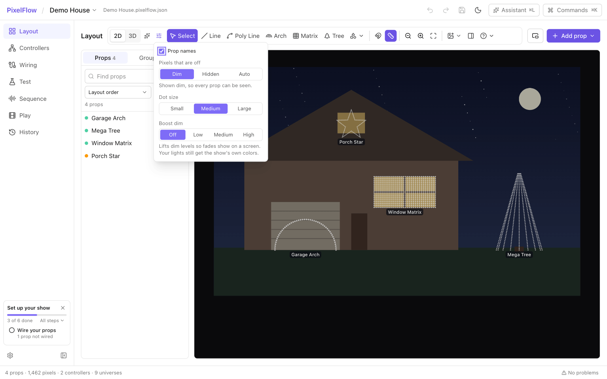
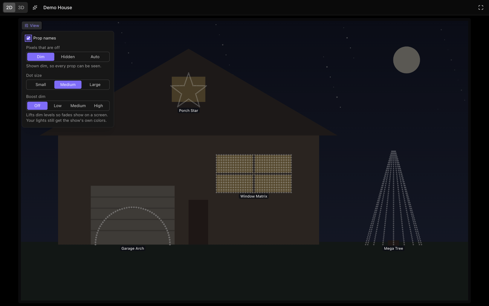

# The 3D view

The 3D view shows your display as it stands: the props in depth, the photo of your house upright
behind them, and, if you add one, a 3D model of the house. You can look at it from the street, from
above, or from the side. This page covers moving around in it, the ground and its grid, the photo
and the house model, and how you like the lights to look: Glow and the View options. The View
options apply to the flat 2D previews too.

The Layout screen has a **2D** and **3D** switch at the left of its tool bar. Press V to switch.
The Sequence screen's preview, the Play screen's preview and the preview's own window each have
their own switch. In the previews the 3D view is for looking only. On the Layout screen you can
also select props and move them in depth.

## Moving around

- **Orbit:** drag in the view. On a trackpad, scroll with two fingers.
- **Pan:** right-drag. You can also drag with the middle button, hold Shift while you scroll, or on
  the Layout screen hold Space and drag.
- **Zoom:** scroll, or pinch on a trackpad. The view zooms toward the pointer.
- **Views:** **Front**, **Top**, **Left**, **Right** and **Street view** are on the bar over the
  view's top-left corner. Street view puts the camera across the street at eye height. On the
  Layout screen, keys 1 to 5 choose them.
- **Fit:** shows the whole display: the props, the photo and the house model. On the Layout
  screen, press F.
- **Focus:** double-click a prop to zoom to it. Double-click empty space to fit everything again.

PixelFlow remembers where you left the camera for each show, on this computer. The previews use
the same camera as the Layout screen.

On the Layout screen, click a prop to select it. Shift-click, or Shift-drag a box, to select more.
Drag the arrows to move the selection along one direction, or the squares to move it across a
plane. You can also drag a prop by its lights to slide it over the ground. **Placement** in the
properties panel sets the depth and tilt exactly. You can only draw new props in 2D.

## The ground and its grid

**Ground** on the view's bar shows or hides the dark ground the display stands on.

A faint grid lies on the ground, like a stage floor, to show depth and scale. It has a line every
round number of layout units and a heavier line every fifth. Layout units have no fixed size in the
world, so the grid takes its spacing from your display: about twenty squares across its width or
depth. Under **View**, **Grid on the ground** shows the spacing, for example "Lines every 1 unit,
heavier every 5 units". In a show imported from xLights a unit is often about a meter, but that
depends on how the layout was drawn.

The grid fades out as it recedes, so the far ground never shimmers. It has its own switch under
**View**, separate from the ground, so you can show the grid without the ground or the ground
without the grid. The photo and the house model hide the grid where they stand in front of it. The
lights and beams always show over it.

## The photo and the house model

The photo you put behind the layout stands upright behind the props, like a backdrop. In 3D, the
**Photo and model** button on the Layout screen's tool bar shows **Photo depth**: how far behind
the props the photo stands. PixelFlow remembers it for each show, on this computer. The photo's
strength comes from its settings on the Layout screen. At more than half strength the photo hides
the lights behind it.

You can also add a 3D model of your house under **Photo and model**, with **Add house model**
(GLB, glTF or OBJ). PixelFlow sizes the model to the photo, or to the props if there is no photo,
and stands it on the ground just behind them. **Fit to display** does that again. Use the model's
position, tilt, turn and scale fields to place it, and **Model strength** to see through it. A
model at half strength or more hides the lights behind it.

When you drag a prop by its lights, it sticks to the model's walls and roof. Hold Alt (Option) to
drag it freely.

## How the lights look

These settings change only how you see the lights on this computer. Every preview follows them,
flat and 3D: the Layout screen, the Sequence and Play screens, and the preview's own window. They
are never saved in the show, and they never change what goes to your lights.

**Glow** is the sparkle button beside the **2D** and **3D** switch. It adds a soft glow around lit
pixels, from none for bare bulbs to more for lights behind diffusers.

**View** holds the rest. It is on the 3D view's bar, over the corner of the flat previews, and on
the Layout screen's tool bar in 2D, beside Glow.

- **Grid on the ground** (3D only): see above.
- **Prop names:** each prop's name in a small tag under it, or over it when there's no room
  below. Where props crowd together, the biggest props on screen are named first, and a name
  that would overlap another is left out. Zoom in to see the rest. Names are off at first.
- **Pixels that are off:**
  - **Dim** (the usual): pixels that are off show as quiet gray dots, so you can see every prop.
  - **Hidden:** only lit pixels show, as the display looks at night.
  - **Auto:** hidden while the show plays, and dim while it is paused or stopped. On the Layout
    screen, Auto always shows them dim, so you can see every prop while you edit.

  When nothing plays at all, every prop shows in its quiet color whatever you choose.
- **Dot size:** **Small**, **Medium** (the usual) or **Large**. Dots still stop short of the
  next pixel of their prop, so only props with room between their pixels get bigger dots. A
  dense string stays a clean line.
- **Boost dim:** **Off** (the usual), **Low**, **Medium** or **High**. A screen shows dim levels
  darker than your eyes see real lights at night, so slow fades can disappear in the preview.
  Boost dim lifts dim levels so fades show, and keeps each light's hue. Full brightness and off
  stay as they are.

The preview's own window has the same **View** button, over the corner of its flat view or on its
3D view's bar. What you choose there applies in the main window too, and the other way round.

## In an exported video

**Export video** on the Sequence screen draws the flat preview. Its **Glow**, **Pixel size**,
**Pixels that are off** and **Boost dim** follow what the previews show until you change them in
the export dialog. Auto counts as Hidden, because a video plays. What you choose in the dialog stays
for your next videos, and the previews keep their own settings. Prop names and the grid are never
in a video.
