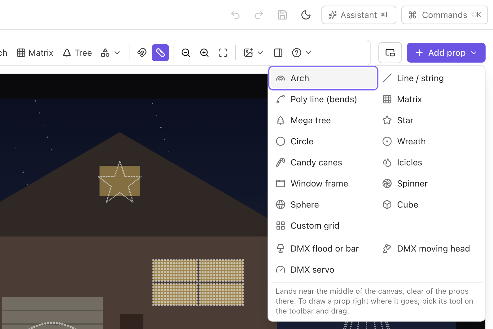
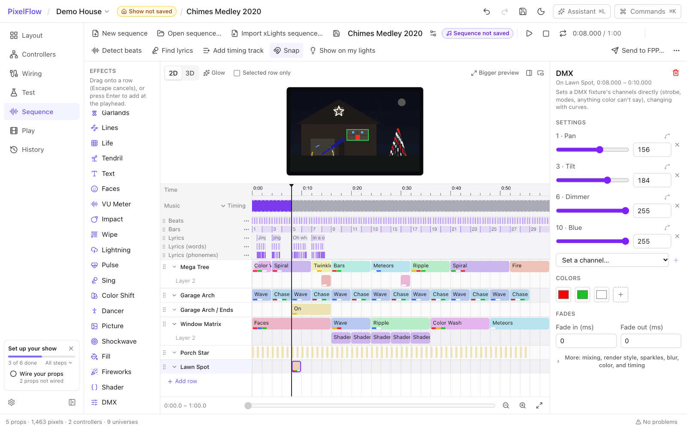
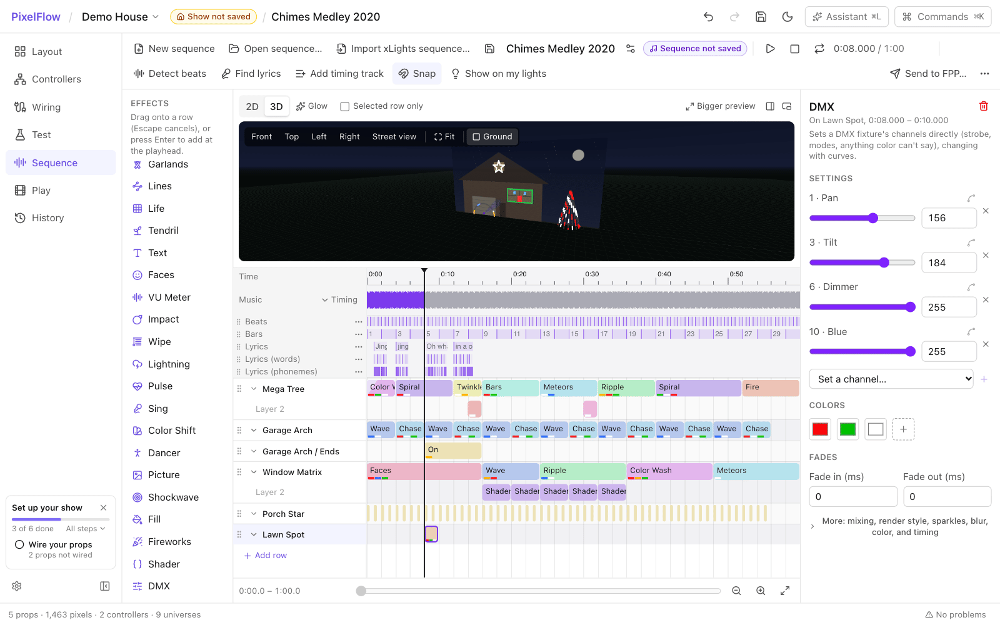
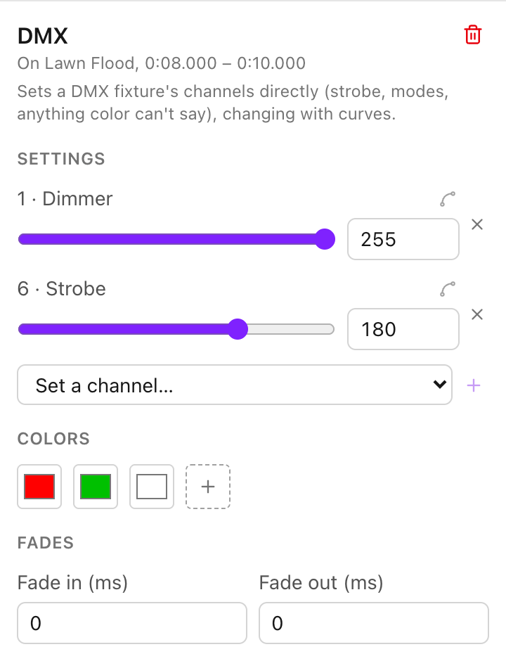
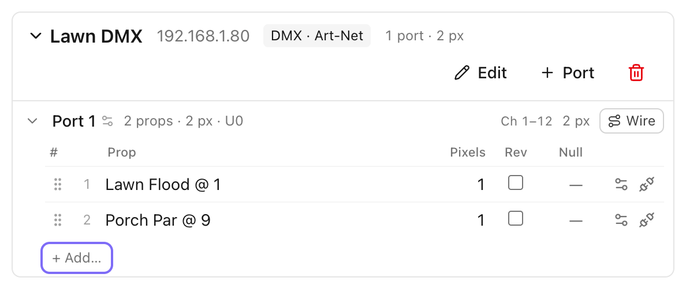
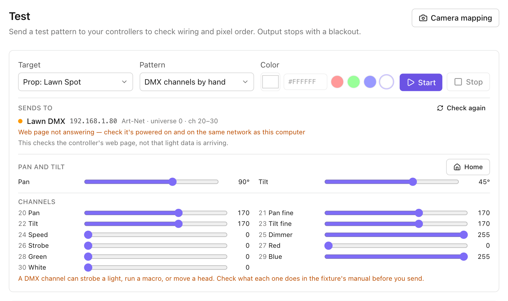

# DMX floods, pars, bars, moving heads, and servos

PixelFlow drives DMX fixtures alongside your pixels: RGB, RGBW, RGBA and RGBWA floods and pars,
usually with a master dimmer and often a strobe, bars of several separately colored cells,
moving heads that pan and tilt, and servos. You color them with the same effects as any prop, and
PixelFlow turns that color into the fixture's channels; the DMX effect points a head or turns a
servo.

> **Safety first.** A DMX universe can drive things that flash or move: a strobe channel is a real
> strobe, a macro channel can start a light show of its own, a moving head swings round, and the
> same universe can carry a fog machine. Before you send anything, know what is on each address of
> the universe, read each fixture's manual for what its channels do, and keep people and things
> out of a head's reach. Keep strobes short.

## Adding a fixture

1. On **Layout**, choose **Add prop ▾ → DMX flood or bar**. A flood lands near the middle of the
   canvas; drag it to where the light is (a flood on the lawn washing the house front, a par at
   the foot of a tree).

   
2. In its properties, under **DMX fixture**:
   - **Channels**: pick the layout from the fixture's manual. The library covers the common ones,
     named by their channels: 3 channels (red, green, blue), 4 (dimmer, red, green, blue), 4 (red,
     green, blue, white), 5, 6, 7 (dimmer, RGBW, strobe, mode), 8 (dimmer, RGBWA, UV, strobe), and
     bars with red, green and blue (or white) for each cell.
   - **Start address**: the address set on the fixture (its DIP switches or menu), 1 to 512.
   - **Cells**, for a bar: how many separately colored sections it has.
   - **Each channel**: for a fixture the library doesn't have, set each channel's name and what it
     does: dimmer, red, green, blue, white, amber, cyan, magenta, yellow, UV, strobe, mode (a
     value held), and the moving-head and servo roles (pan, tilt, servo, their fine channels,
     speed, color wheel, gobo, zoom; see [Moving heads](#moving-heads) and [Servos](#servos)). A
     channel that isn't a color holds the value you give it, unless a DMX effect sets it: put the
     mode channel at the value the manual gives for "DMX control".
   - **Strobe: what its values do**: what the strobe (or shutter) channel's values do, from the
     manual, so the previews show the light as the fixture would (see
     [Strobe and shutter](#strobe-and-shutter)).

Several fixtures share one universe: give each its own start address, after the last channel of
the one before. The Wiring screen warns when two overlap.

## How a color becomes channels

- **Dimmer.** On a fixture with a dimmer channel, the dimmer carries the brightness and the color
  channels carry the color at full. Floods have 8-bit color channels: a dim orange sent through
  them alone loses its hue (orange at 5% is red 13, green 5), and a slow fade steps. Through the
  dimmer the hue stays true and the fade is as smooth as the fixture's dimmer. On a bar, the one
  dimmer follows the brightest cell. Without a dimmer channel, the color channels carry the
  brightness.
- **White** is the part of the color that red, green and blue share; it comes out of them and
  goes to the white LEDs, which make a whiter white.
- **Amber** stands for orange (255, 128, 0): after white, as much of the color as is orange goes
  to amber.
- **Cyan, magenta and yellow**, on a fixture that mixes color by taking it out of a white lamp,
  are what the color leaves out: cyan is 255 less the red, and so on.
- **A color wheel** with its colors listed turns to the one nearest the color drawn (the dimmer
  carries the brightness). Where nothing is drawn, it stays where it is. Without its colors
  listed, it holds its value like a mode channel.
- **UV, strobe, mode, speed, gobo and zoom** channels hold their value.

The previews show the color the channels make, as a soft wash around a flood: the same wash,
from the same numbers, in the 2D previews, the 3D view and an exported video, dark while its
shutter is closed (see [Strobe and shutter](#strobe-and-shutter)). A moving head shows a beam
instead (see below).

## Moving heads

A moving head is a fixture with a pan channel (it turns round) and a tilt channel (it leans), each
with a fine channel when it is a 16-bit head, and its light: red, green, blue and white, a color
wheel, or cyan, magenta and yellow, usually with a dimmer and a shutter.

1. On **Layout**, choose **Add prop ▾ → DMX moving head**: a common 16-bit head with pan, pan
   fine, tilt, tilt fine, speed, dimmer, strobe, red, green, blue and white. Drag it to where it
   stands.
2. Under **DMX moving head**, pick its **Channels** from the library (16-bit and 8-bit heads, and
   a spot with a color wheel and a gobo), or set **Each channel** from its manual, and its
   **Start address**.
3. Open **Pan and tilt** and set how it moves, from its manual:
   - **Turns**: how many degrees it pans (or tilts) as the channel goes from 0 to 255 (the manual's
     "pan 540°, tilt 270°").
   - **Home at**: where Home is, in degrees from the 0 end. Home is the head facing forward (toward
     the street) and pointing straight up. It is the middle of the travel on most heads.
   - **Limits**: how far it may turn each way from Home (left and right for pan, back and forward
     for tilt), to keep it off a wall or out of the neighbors' windows.
   - **Reversed**: it turns the other way as the value rises.
   - **Hung upside down**: it hangs from its base (turned half round in the front plane). To point
     it another way, turn the prop on Layout.
   - **Beam width** (the fixture's beam angle) and **Beam drawn** (how far the previews draw it).
     A head with a zoom channel (set a channel's role to **Zoom**) has **Zoom at 0** and **Zoom at
     255** instead: how wide its beam is at either end of the channel, from the manual; in
     between, the beam widens in proportion.

A head rests where its pan and tilt channels hold their values: a head made from the library, or
imported from xLights, rests at Home. Positions are always in degrees from Home, so they mean the
same on any head, 16-bit or 8-bit, standing or hung.

A color wheel lists its colors under **Color wheel: its colors**: each color, and the value that
turns the wheel to it, from the manual. With its colors listed, effects that draw color on the
head turn the wheel.

## Servos

**Add prop ▾ → DMX servo** adds one 16-bit servo (two channels: its position, then fine). Pick
**Servos, 1 channel each** for 8-bit ones, and set **Servos** to how many share the fixture: each
is drawn as an arm at its own place. Under **Servos**, each one's settings are a head's: how far
it turns, where Home is, its limits, and whether it is reversed. Servos make no light of their
own.

## Pointing a head with the DMX effect

The DMX effect (below) points a head: set its pan and tilt channels, and its fine channels for a
smooth move on a 16-bit head, and sweep them with curves. Its color comes from what is drawn on
it, on a layer below, or from its dimmer and color channels set in the same effect. The previews
draw the head's beam where it points, in its color; a servo's arm turns.

## In the previews

The previews show a head as the real light would look at night.

- **A moving head** shows a beam from where it stands, where its pan and tilt point it, as wide
  as its beam angle (or its zoom channel) makes it. It is in the color the head shows and as
  bright: its dimmer, or the color's own brightness when it has no dimmer, makes it fainter or
  stronger. Narrow near the head, the beam is bright; where it has spread wide it is softer, as a
  real beam's light spreads out, and it fades out toward the end of the length it is drawn. So
  it reads in the small preview beside the timeline and isn't blown out in a big one. Pointing
  toward you, its end is a soft glow round the head.
- **A beam pointing down** stops where it meets the ground and lights a pool of light there,
  stretched the more the beam slants.
- **Its shutter and strobe**: a closed shutter is dark, and a strobe flashes (see below).
- **Nothing playing**: with the lights off, nothing is lit. On **Layout**, a selected head shows a
  thin dashed outline of where it points, to help you aim it; it is never drawn as light.
- **A servo** shows an arm that turns with it, up at Home.
- The 2D previews and an exported video draw them alike, from the same numbers; the 3D view draws
  the beam as a cone by the same rules, which the house model hides where it stands in front of
  it.

A head moves in the previews to where its channels point it at each moment, at once: a real head
takes a moment to get there.

### Strobe and shutter

A fixture's strobe channel (often called shutter) says when its light shows. Under **Strobe: what
its values do**, list what its values do from the manual: ranges, each from a value up to where
the next starts, each **Closed**, **Open**, or **Strobe**, slow to fast (from one flash a second
at the range's first value to 20 a second at its last). Values below the first range are open.

Until you set them, a strobe channel does what most fixtures' strobe channels do: open from 0 to
9, then a strobe from slow (10) to fast (255). A fixture imported from xLights is closed below the
shutter's open value and open from it up. **Use the usual** goes back to the usual ranges. A show
saved by an older PixelFlow keeps looking as it did: a strobe channel there that holds 10 or more
is open at every value until you set its ranges.

The previews show a closed shutter dark, and a strobe flashing: a flash shows in the frames where
one fires, worked out from the moment alone, so stopping on a moment shows what playing through it
does. A strobe faster than half the sequence's frame rate shows as a flash every other frame, the
fastest the frames can show. What is sent to the fixture is its channels, as they are: the fixture
does its own strobing.

## The DMX effect

The **DMX** effect sets any of a fixture's channels directly, by number from its start address
(channel 1 is the fixture's first), each 0 to 255, and each can change over the effect with a
curve: a strobe burst on a hit, the dimmer swelling up into a chorus, a mode or macro. Channels it
doesn't set come from the color drawn on the fixture as usual, so put it on a layer above an
`On` or `Color Wash`. On a group, it sets that channel of every fixture in the group. Where two
DMX effects set one channel at once, the later row (or the higher layer) wins. It draws no color
and isn't faded by fades.

To set a channel, pick it in **Set a channel…** and choose the **+** beside it; the **×** beside a
channel stops setting it.

## Wiring: DMX nodes and USB interfaces

On **Wiring**, choose **Add controller** and a DMX controller type:

- **DMX node (Art-Net)** or **DMX node (sACN)**: a box on your network with DMX outputs. Each port
  is one DMX universe. Leave the start universe empty to let PixelFlow number them (Art-Net from
  0, sACN from 1), or set the one the node listens on. PixelFlow sends every universe whole, all
  512 channels, every frame, as DMX receivers expect. Art-Net goes to the node's address on UDP
  port 6454 (PixelFlow doesn't poll for nodes: give it the address); sACN to port 5568, or by
  multicast.
- **USB DMX interface**: an interface that speaks the ENTTEC DMX USB Pro protocol (many do). Its
  address is its serial port (`/dev/cu.usbserial-…` on a Mac, `/dev/ttyUSB0` on Linux, `COM3` on
  Windows). The ports PixelFlow can see are offered by what each device calls itself, such as
  "ENTTEC DMX USB Pro (cu.usbserial-EN123456)"; listing them doesn't open any. One universe. See
  [USB DMX interfaces](#usb-dmx-interfaces) below.

Pick the port from the list the **Serial port** box offers, or type it.

Drag each fixture onto its universe (or use **+ Add…**): it goes to its own start address, shown
as "@ 9". A DMX controller can't drive pixels; the Wiring screen says so.

A pixel controller with a DMX output (a Falcon's or an FPP's DMX port, fed from its own
universes) carries fixtures too: wire the fixture on that controller's port after its pixels,
with null channels before it if there's a gap. It takes its channels where it falls, in one piece
(never split between two universes), and the Wiring screen warns when that isn't the start
address set on the fixture.

## From xLights

An xLights show's DMX fixtures import wired on their controller at the channels xLights gives
them, beside its pixels. The import report says how each kind comes across:

- **Floods** (`DmxGeneral`, `DmxFloodlight`, `DmxFloodArea`) become fixtures with their color
  channels and their shutter, held open: the previews draw it closed below the open value the
  file gives, and open from it up.
- **Moving heads** (`DmxMovingHeadAdv`, `DmxMovingHead`, `DmxMovingHead3D`): "Matches". They
  become moving heads with their pan and tilt (and fine channels), how far each turns, where
  Home is, their limits and whether each is reversed, their colors (red, green, blue and white, a
  color wheel with its colors, or cyan, magenta and yellow), dimmer, shutter and gobo channels,
  and their beam width. Where nothing moves them, they rest at Home (xLights sends their pan and
  tilt 0 there, which on most heads is a corner of their travel).
- **Servos** (`DmxServo`, `DmxServo3d`): "Matches". Each servo keeps its channels (16-bit or 8-bit)
  and its limits, with Home between them, and is drawn as an arm.
- "Close", for a head that hangs upside down (PixelFlow turns it half round; it sends what xLights
  sends, but may draw the beam another way), a color wheel whose colors the file doesn't list (the
  beam is drawn white), or a head whose file doesn't say which channels are its pan and tilt.
- "No equivalent": skulls and other DMX models stay rows of channel dots, not wired.

A sequence's DMX effects come across as DMX effects, so they point the heads as in xLights.
xLights' Moving Head and Servo effects have no PixelFlow effect yet: the report lists them as left
out.

## Testing

On **Test**, pick the fixture as the target and choose **DMX channels by hand**: a slider for each
channel, live on the fixture while you move it. Any other pattern lights the fixture through its
color, like a pixel. The same rules apply as for every test, over the network or USB: nothing is
sent (and no USB interface is opened) until you press Start, and Stop sends black.

On a moving head, **Pan and tilt** above the channels moves it in degrees from Home, each within
its limits, and **Home** sends it back there; servos get a slider each. They set the pan and tilt
channels and their fine channels for you.

**Stopping never swings a head.** Black (Stop, the end of playback, or a controller no longer sent
to) puts out every light, but leaves the channels that move a head or a servo where they were, so
it stays pointing where it was. This holds for a sequence played straight through from its
`.fseq` too.

## USB DMX interfaces

PixelFlow drives interfaces that speak the ENTTEC DMX USB Pro protocol: the ENTTEC DMX USB Pro
and Pro Mk2 (its first universe), and the many interfaces that copy the Pro's protocol, such as
DMXking's ultraDMX range. Each frame it sends the interface the universe's 512 channels as one
"send DMX" message; the interface makes the DMX signal itself and repeats the last message it was
given until the next one comes.

- **How often.** One message per show frame, but no more often than a DMX line can carry a whole
  universe (about 44 a second): a show at 40 frames a second sends every frame, a faster one the
  newest frame each time.
- **The port.** PixelFlow opens the port only when you start a test or playback, and holds it
  while it sends: another program can't use the interface at the same time (close other lighting
  software first). It opens only real serial ports: a name in a show file that isn't one of this
  computer's serial ports is refused.
- **Unplugged mid-show.** The controller turns to "degraded" in the Test screen's list, with
  "the USB DMX interface on … stopped answering: was it unplugged?", and everything else carries
  on. PixelFlow tries again after a moment, less often the longer it's gone (up to every five
  seconds), and picks the interface up again by itself once it's plugged back in on the same
  port. An interface that is still there but stops taking data is given 20 ms per message before
  it counts as stuck, so it never holds up the rest of the show.

### Setting up, by system

- **macOS.** The Pro and most copies appear as `/dev/cu.usbserial-<serial number>` (FTDI chips,
  with the driver built into macOS) or `/dev/cu.usbmodem…` (interfaces that are USB serial
  devices themselves). Use the `cu.` port; each also has a `tty.` twin, meant for modems. No driver
  to install. If PixelFlow is ever built as a sandboxed app, it needs the
  `com.apple.security.device.serial` entitlement to open serial ports (today's builds aren't
  sandboxed and need nothing).
- **Linux.** The interface appears as `/dev/ttyUSB0` (FTDI, the `ftdi_sio` driver) or
  `/dev/ttyACM0` (`cdc_acm`). Opening it needs your user in the group that owns it: `dialout` on
  Debian, Ubuntu and Fedora, `uucp` on Arch (`sudo usermod -aG dialout $USER`, then sign out and
  in again). Without it, Test says PixelFlow isn't allowed to open the port. A name that stays the
  same whichever USB socket you use is under `/dev/serial/by-id/`; PixelFlow accepts those too.
  The port list comes from `/sys`, so nothing extra (no libudev) needs to be installed.
- **Windows.** The interface is a COM port (`COM3`, say) through FTDI's VCP ("virtual COM port")
  driver, which Windows Update usually installs (if not, it's on FTDI's website); Device Manager
  under **Ports (COM & LPT)** shows its number. Windows lets only one program open a COM port at a time.

### Interfaces that aren't supported

"Open DMX"-style interfaces (the ENTTEC Open DMX USB and its many copies: a bare FTDI chip with no
processor of its own) don't speak the Pro protocol. With them the computer has to make the DMX
signal itself: switch the line to 250 kbaud, make the break and the mark after it with exact
timing, and send all 513 slots, again and again. A desktop system's scheduling makes that timing
waver, which fixtures show as flicker, and doing it well needs FTDI's own closed-source driver.
PixelFlow doesn't drive them; use a Pro-compatible interface or an Art-Net or sACN node instead.
