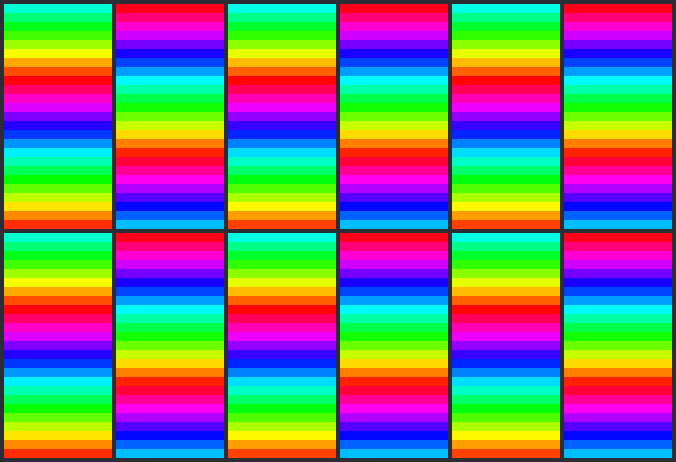
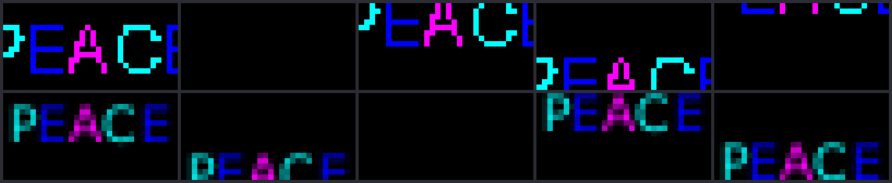

# xLights import fidelity

**Fidelity is how an imported sequence looks.** Someone who made a show in xLights and imports it
into PixelFlow wants the same show: the right props lit, in the right colors, moving the same way
at the same speed, to the same rhythm. That is all fidelity means here.

It does not mean the same pixels. Two renders of falling snow never light the same pixels, in
xLights or anywhere else, and nobody watching can tell. And it does not mean building an effect
the way xLights builds it: PixelFlow is free to draw an effect its own way, and a faster or
simpler way is better, as long as the result looks the same.

`pf-fidelity` measures this. Given an xLights show folder, a sequence, and the `.fseq` xLights
saved for that sequence, it renders the sequence in PixelFlow and compares the two renders by
how they look. It works from the renders and knows nothing of how either was made, but for one
thing it is told of each effect: whether chance decides when its light comes (see "Effects that
draw on chance").

```sh
# One sequence: prints the scorecard, or writes <label>.json and <label>.md with --out.
cargo run --release -p pf-fidelity -- score \
  --show path/to/show --xsq path/to/song.xsq --fseq path/to/song.fseq --out reports/

# Every sequence a manifest lists, scored together.
cargo run --release -p pf-fidelity -- corpus path/to/corpus.json --out reports/
PF_FIDELITY_CORPUS=path/to/corpus.json cargo run --release -p pf-fidelity -- corpus --out reports/

# The same with every effect held moment by moment against xLights' render alone: the numbers
# from before effects that draw on chance were held against PixelFlow's other seeds.
cargo run --release -p pf-fidelity -- corpus path/to/corpus.json --by-moment --out reports/

# The importer's table of expected looks, held against a scorecard.
cargo run --release -p pf-fidelity -- labels reports/corpus.json

# Frames side by side (xLights' above, PixelFlow's below), to see a difference for yourself.
cargo run --release -p pf-fidelity -- strips --show … --xsq … --fseq … \
  --effect 12 --target Matrix --frames 10 --levels --out strips/

# The score held against PixelFlow's own renders, where the answer is known (no xLights needed).
cargo run --release -p pf-fidelity -- calibrate --out reports/

# The corpus in the repository, as CI checks it (see "The corpus in CI"), and accepting a change.
cargo run --release -p pf-fidelity -- fingerprint            # PixelFlow's own render
cargo run --release -p pf-fidelity -- regress                # the looks next to xLights'
cargo run --release -p pf-fidelity -- fingerprint --accept   # a change to what PixelFlow draws
cargo run --release -p pf-fidelity -- regress --accept       # a change to how the imports look
```

## The verdicts

Every effect gets one of four, and so does every line of an import's report:

| Verdict | Means | In the import report |
|---|---|---|
| **Matches** | A viewer wouldn't tell the two apart at show distance. | "comes across the same" |
| **Close** | The same idea, with differences a viewer could notice. | "looks close: slower than in xLights" |
| **Different** | It reads as a different look. | "looks different: shown as falling meteors" |
| **No equivalent** | PixelFlow has no effect for it yet; a dim stand-in is shown. | "no PixelFlow effect yet" |

## The look score

An effect's look has six parts. Each is scored from 0 (nothing alike) to 1 (alike), on the
target's own grid: a matrix's columns and rows, a tree's strings and the pixels up them, a line's
pixels in a row, a group's layout.

| Part | Asks | How |
|---|---|---|
| **Coverage** | Is as much of the prop lit, all the way through? | The share of pixels lit, as a curve over time (smoothed over half a second): how much of the two curves is the same. |
| **Brightness** | Is it as bright, and does it rise and fall the same? | The same for mean brightness. Half as bright halves it; so does a fade the other render doesn't have. |
| **Color** | Are they the same colors, in the same shares? | Second by second, each render's light sorted into hue bins 15° wide and one for white, weighted by brightness. Light in the same bin matches; a hue up to 45° off matches in part; white matches only white. |
| **Pattern** | Is the light in the same places, with the same fineness? | The layout: the picture on a grid of at most 8 by 8, relative to its own brightness, the better of as it is and moved one cell. Times the texture: how alike cells are that are 1, 2, … 16 cells apart, which is the spacing of stripes and the size of dots. |
| **Motion** | Does it move the same way, as fast, and change as much? | The move that best lays each row and column of the picture on itself a moment later gives a direction and a speed (opposite scores 0, half speed a half). And the share of the light that changes from frame to frame. The lesser of the two. |
| **Rhythm** | Does it pulse in step, and flash as often? | The brightness with its slow curve taken off, the two held against each other a frame either way (a strobe at another rate, or out of step, scores low). And how often dark pixels light up. The lesser of the two. |

Four things keep the score honest.

**People notice ratios.** Each part is how much of the two renders is the same, passed through
one curve: a fifth off passes for the same (0.97), half off is half alike (0.5), three quarters
off has next to nothing in common (0.11).

**A render isn't asked to be more like the other than it is like itself.** The pixels are split
in two at random. What the two halves of one render disagree on (which pixels twinkle) is
chance, and is taken off before the renders are compared. A layout that doesn't hold still
within one render (blobs coming and going) isn't asked to be where the other render has it. A
speed is only as sure as its readings agree.

**Nor more like xLights than it is like itself from another seed.** Splitting the pixels allows
for chance that is each pixel's own. A burst, a ball, or a flake moves many pixels together:
both halves of a render see it, and no other render has it at that moment in that place. So
where an effect draws on chance, PixelFlow renders the sequence again from other seeds, and
what its own renders disagree on isn't held against the import. Where an effect's moments are
chance, the parts of its look that chance moves are read over the whole effect, not moment by
moment. "Effects that draw on chance" has the rule, the effects it applies to, and what it
costs.

**One thing badly wrong reads as a different look.** The composite, 0–100, is 70% the weighted
mean of the parts and 30% the weakest part. The weights: color 0.25 and pattern 0.20, because
they are what a viewer names first ("the red spiral"); coverage, brightness, and motion 0.15
each; rhythm 0.10, because a rhythm that is off nearly always shows in brightness or motion too.

A score of 85 or more **matches**, 55 or more is **close**, and under 55 is **different**. A
placeholder has **no equivalent** whatever it scores. The lines were drawn by looking: frames
side by side (`strips`) for a spread of effects, and the verdicts moved until they agreed with
what the pictures showed. Some of what settled them:

| What was on the lights | Pixel for pixel | Look | Verdict |
|---|---|---|---|
| A cellular automaton alone on a row of small props for nine minutes: the same sparse dots in other places | error 84 of 255, lit agreement 0.69 | 94 | Matches |
| Plasma on two thin outline props: the same mottling, the blobs elsewhere | error 48 | 100 | Matches |
| Twinkles covering a tree with text over them | error 63, lit agreement 0.48 | 99 | Matches |
| Fire alone on a group that spans the layout: flames on the same props in the same colors | error 7 | 99 | Matches |
| A fill rising up a matrix with sparkles | error 10 | 100 | Matches |
| A tendril wandering two outline props: the same colors, less of it lit, pulsing at other moments | error 52 | 63 | Close |
| A wash on a group of outline props, one of them in another color | error 40 | 57 | Close |
| Fire over a group of outline props where xLights lights one of them blue and little else | error 98 | 47 | Different |
| Fireworks drawn as steady twinkles (before it had an effect of its own), where xLights is dark between bursts | error 26 | 22 | Different |
| Snow on a tree that PixelFlow also washes blue and the reference leaves dark (the file turned out to be unfinished there) | error 94 | 5 | Different |
| A shader shown as a dim fill (before the Shader effect) | error 57–108 | 13–40 | No equivalent |
| A shader drawn with its own file, on a group across the layout | error 0.13–0.15, every pixel within tolerance | 100 | Matches |

## Effects that draw on chance

Fireworks go off at moments and in places no two renders share, in PixelFlow or in xLights. Held
second against second, two good renders of the same fireworks have no color in common and never
pulse together, and that used to cap such an effect at a look of about 45, "different", however
alike the two were. The same fault moved other scores from run to run: a wandering ball is
somewhere else in every render, a game of life settles into other shapes, and a sparkle falls
on another pixel.

Three things are done about it. They are kept apart, because only the second could hide a
fault, and the third is there to stop the first from hiding one.

**What PixelFlow's own renders disagree on is chance.** An effect draws its chance from its
seed. Where any effect of a sequence draws on chance, PixelFlow renders the sequence twice more,
every effect from another seed (`--seeds` changes how many). Each part of a look is then how
much PixelFlow's renders have in common with xLights' on average, next to how much the two of
PixelFlow's own renders that are least alike have in common with each other. Where its renders
agree from seed to seed, nothing is allowed. Where they differ in which pixels sparkle, where a
ball started, which color a burst took, or how many bursts crossed a prop, that much is allowed
and no more. This is done for both looks of an effect that draws on chance, and for the layered
look of an effect that shares its pixels with one: the picture there changes from seed to seed
whoever drew it. An effect that draws on nothing, on pixels nothing else draws on by chance, is
judged exactly as before, to the last digit.

**Where the moments are chance, the parts chance moves are read over the whole effect.** Held
moment against moment, two renders of bursts at chance moments have next to nothing in common,
PixelFlow's own included, and next to nothing over next to nothing says nothing of whether the
colors are right. So for an effect whose moments are chance, a part of the look that
PixelFlow's own renders have less than half of in common moment by moment is read with the
order of the moments set aside:

| Part | Over the whole effect |
|---|---|
| Coverage | The same curve of the share of pixels lit, sorted from its highest moment to its lowest: how much of the time how much is lit, and how much of the time it is dark. |
| Brightness | The same for mean brightness. |
| Color | All the light of the effect sorted into the same hue bins once, not second by second. |
| Pattern | Where the light fell over the whole effect, on the same grid of at most 8 by 8, in place of where it is at each look. Light a single burst left where it happened to go off counts for no layout of the render's own, and a render too dim on the whole to have a pattern (a few sparks crossing a prop) has no layout. Times the texture, as before. |
| Motion | Which way the picture moves over all its one-second windows together, how fast, and the share of its light that changes from frame to frame: three amounts, each held against PixelFlow's seeds (below). Whether the two move the same way in each window is not asked. |
| Rhythm | How often dark pixels light up: an amount, held the same way. Whether the two pulse in step is not asked. |

A part PixelFlow's renders do share moment by moment is still read that way. Snow over a
steady wash has its moments left to chance, and the wash under it is held to its own.

Which effects those are is declared from the effect's kind and settings
(`pf_fidelity::chance`), and never read off xLights' frames: an effect that ought to keep time
and doesn't would look just like one chance moves. An effect set off by its own clock, a timing
track, or the music keeps its moments, whatever else it draws by chance, and is held moment by
moment, so that coming in late shows.

| Effect | Chance decides | Why |
|---|---|---|
| Fireworks, bursting at random moments | its moments | Each burst goes off at a moment, in a place, and in a color drawn from the seed. |
| Shape, with a staggered start and no timing track or music | its moments | Each shape keeps time from a chance start of its own, in a chance place. |
| Circles (balls, bubbles, plasma blobs) | its moments | The balls start in chance places and head off in chance directions at chance speeds. Nothing brings one back at a set moment. |
| Meteors | its moments | Each meteor falls in a chance lane, starting at a chance moment. |
| Snowflakes | its moments | The flakes are scattered by chance, and new ones start at chance moments. |
| Lines | its moments | The lines start in chance places and head off in chance directions. |
| Lightning | its moments | It strikes at chance moments. |
| Tendril, moving at random | its moments | The point it follows wanders by chance. |
| Fireworks or Shape on a timing track or with the music; Shape with every shape starting together | what it draws | Each appears when the track, the music, or the clock says, in a chance place and color. |
| Life | what it draws | A new generation comes by the clock. The cells it starts from are chance. |
| Fire | what it draws | It burns where and as high as it is set to (or as the music is loud). Its flames flare by chance. |
| Twinkle, Strobe | what it draws | Each pixel twinkles from a chance moment of its own, and over a prop they add up to the same light at every moment. A strobe flashes by the clock on chance pixels. |
| VU Meter's random bars | what it draws | The bar lights with the music or on a mark. Which bar is chance. |
| Faces with blinking eyes | what it draws | It sings from its timing track. Its blinks fall at chance moments. |
| Any effect with sparkles | what it draws | Each lit pixel flashes at a moment of its own. |
| Everything else, and Circles' rings, a Tendril on a set path | nothing | Worked out from the clock, the settings, a timing track, the music, or a file. Every render is the same. |

A kind added to PixelFlow has to be given a line in that table before `pf-fidelity` builds.

**And there has to be as much of it.** What chance leaves in common between two renders can be
little, and half of little passes for little: a ball half the size, somewhere else at every
moment, has nearly as much in common with xLights' ball as PixelFlow's own renders have with
each other. So next to other seeds, coverage and brightness are also held to how much is lit
and how brightly over the whole effect. PixelFlow's seeds give an average and a spread.
xLights' amount within what the spread allows is chance, and counts for nothing; from twice
that far it counts in full, the smaller amount over the larger; in between, a share of it.
What the spread allows is one and a half times a spread that is sure. A spread read from
three renders is itself a matter of chance and often too small, so it is allowed 2.45 times
(Student's t, at the same odds), and a little more for the average of three being only so
sure. Over the whole effect, movement and rhythm are amounts too, and are held the same way.
That reads chance that is drawn once for a whole effect, such as which way three balls set
off, better than how alike any two renders happen to be.

**How much it takes to say anything.** The allowance is measured, not assumed, so it is as wide
as chance is. Sixty bursts differ little from one seed to the next, and a render with half as
many is caught. Four bursts differ as much from seed to seed as from a render with eight, and
nothing can tell those apart, a viewer least of all. Each look next to other seeds says how
alike PixelFlow's own renders were in each part (`own` in the scorecard), and in the part they
had least of in common (`itself`, and `least` for which). Two things make a look say too
little:

- *Too little light.* Both renders light under one pixel in a hundred of what was looked at,
  which every look takes as none. A few sparks crossing an outline are that, however alike the
  specks happen to be from one seed to the next.
- *A part that chance moves by a factor of two.* PixelFlow's own renders have less than half of
  some part in common. A match can't be told from chance there, so a look that matches says
  too little, and so does one whose difference rests on that part. A difference found on the
  other parts stands: a look that would earn the same verdict with full marks for every such
  part is judged on it.

**An effect whose look says too little is not judged.** A score of 100 that chance alone would
give is no evidence that an import matches, and it isn't counted as any. The effect is in no
share, score, or count of the effects judged, for its kind, its sequence, or the corpus, and
the importer's label for it is held against nothing. It is listed apart, with the look it got,
what that would have earned, and why it says too little ("Not judged: looks that say little"),
and the summary says how much of the effect-time that is. A short effect is looked at the same
way, and for the same reason is more often not judged. Moment by moment (`--by-moment`, and the
"by moment" numbers a scorecard keeps beside the others) every effect is judged, as all were.

**What it can no longer tell**, for a part read over the whole effect:

- *The order of things over the effect.* Sorted curves and a single palette are the same for a
  fireworks that builds up as for one that dies down, for a fade in as for a fade out, and for
  colors that come in another order. Only how much of each there is over the whole effect is
  compared.
- *Whether it pulses in step with anything.* That is the point for bursts at chance moments. It
  is also why a burst fired by a timing track or the music is not declared so.
- *Where each thing is at each moment.* Where the light fell over the whole effect is still
  compared: every burst in the middle of the prop against bursts all over it is caught.

And for any look held against other seeds:

- *What PixelFlow leaves to chance and xLights doesn't.* The allowance is what PixelFlow's own
  renders disagree on. If PixelFlow scattered by chance something xLights always puts in one
  place, the scatter would be allowed. Only PixelFlow can be rendered again, so xLights' own
  chance is never seen: it is taken to be as large.
- *A difference smaller than chance.* Where chance is as large as the look, the effect is not
  judged at all (above). Where it is judged, the calibration below says how large a
  difference is told.
- *A steady effect's fault under a busy one.* An effect that keeps time is held to it as far as
  the picture it is judged in keeps still from seed to seed. Under falling snow that is nearly
  all the way. Under something that changes most of the picture, most of the fault is allowed.
- *What is too sparse or too dim to count.* This is not new. A share of pixels lit under one in
  a hundred, a brightness under 0.4%, and fewer than one flash per pixel every four seconds are
  each taken as nothing, for every effect. Fireworks as xLights' usual settings come across
  light a few pixels in a thousand of a group of outline props, and twice as many bursts there
  is twice next to nothing.

`--by-moment` judges every effect moment by moment against xLights' render alone, as all were
before. A scorecard made without it shows both: each effect held against other seeds has the
look it scores by moment beside the one it is judged on, and "How it looks" gives the whole
sequence both ways.

### Calibration

`pf-fidelity calibrate` holds the score against PixelFlow's own renders, where the answer is
known. One render of an effect stands in for xLights' frames, and the effect is rendered again
from other seeds, or with one setting changed, and scored against it as an import is against
its reference. The tables below are its output: effects 60 seconds long in 25 ms frames, each
line scored eight times from fresh seeds, on a 32 by 16 matrix and on a group of eight outline
props (1,200 pixels on a grid of 400 by 179 cells, so that most of what an effect draws falls
between the props). "By moment" is the look held moment by moment against the one render
alone, as every effect was judged before. "Next to other seeds" is what an effect that draws
on chance is judged on now. A look is the middle score of the eight with the least and the
most, whether or not each says enough to judge by; the counts are matches / close / different,
and for a look next to other seeds how many of the eight say too little and are not judged;
"itself" is as above, averaged, with the part PixelFlow's own renders most often had least of
in common; the parts are coverage, brightness, color, pattern, motion, and rhythm, averaged.

#### The same effect from other seeds

Every line that is judged should match.

| Effect | Shown | On | Chance decides | By moment: look (least–most) | Matches / close / different | Next to other seeds: look (least–most) | Matches / close / different / not judged | Itself | Parts |
|---|---|---|---|---|---|---|---|---|---|
| Fireworks | the same | matrix | its moments | 51 (44–57) | 0 / 2 / 6 | 100 (93–100) | 7 / 0 / 0 / 1 | 0.51 rhythm | 1.00 1.00 1.00 0.96 1.00 1.00 |
| Fireworks, big bursts | the same | matrix | its moments | 49 (42–57) | 0 / 1 / 7 | 100 (97–100) | 8 / 0 / 0 / 0 | 0.52 rhythm | 1.00 1.00 1.00 0.99 1.00 1.00 |
| Fireworks, as imported | the same | matrix | its moments | 42 (37–44) | 0 / 0 / 8 | 100 (100–100) | 0 / 0 / 0 / 8 | 0.59 coverage | 1.00 1.00 1.00 1.00 1.00 1.00 |
| Fireworks, dark between bursts | the same | matrix | its moments | 24 (21–25) | 0 / 0 / 8 | 100 (96–100) | 8 / 0 / 0 / 0 | 0.62 color | 1.00 1.00 0.99 1.00 1.00 1.00 |
| Circles | the same | matrix | its moments | 58 (54–78) | 0 / 7 / 1 | 100 (78–100) | 0 / 1 / 0 / 7 | 0.05 motion | 1.00 1.00 1.00 1.00 1.00 0.93 |
| Meteors | the same | matrix | its moments | 100 (100–100) | 8 / 0 / 0 | 100 (100–100) | 8 / 0 / 0 / 0 | 0.90 motion | 1.00 1.00 1.00 1.00 1.00 1.00 |
| Snowflakes, blowing | the same | matrix | its moments | 100 (83–100) | 7 / 1 / 0 | 100 (100–100) | 8 / 0 / 0 / 0 | 0.73 rhythm | 1.00 1.00 1.00 1.00 1.00 1.00 |
| Snowflakes, falling | the same | matrix | its moments | 100 (100–100) | 8 / 0 / 0 | 100 (100–100) | 8 / 0 / 0 / 0 | 0.88 motion | 1.00 1.00 1.00 1.00 1.00 1.00 |
| Lines | the same | matrix | its moments | 68 (67–72) | 0 / 8 / 0 | 100 (100–100) | 8 / 0 / 0 / 0 | 0.77 motion | 1.00 1.00 1.00 1.00 1.00 1.00 |
| Lightning | the same | matrix | its moments | 50 (48–51) | 0 / 0 / 8 | 100 (100–100) | 8 / 0 / 0 / 0 | 0.89 pattern | 1.00 1.00 1.00 1.00 1.00 1.00 |
| Tendril, wandering | the same | matrix | its moments | 94 (93–96) | 8 / 0 / 0 | 100 (98–100) | 8 / 0 / 0 / 0 | 0.67 rhythm | 1.00 1.00 1.00 1.00 1.00 1.00 |
| Shape | the same | matrix | its moments | 60 (56–65) | 0 / 8 / 0 | 100 (100–100) | 6 / 0 / 0 / 2 | 0.55 pattern | 1.00 1.00 1.00 1.00 1.00 1.00 |
| Shape, all at once | the same | matrix | what it draws | 62 (61–67) | 0 / 8 / 0 | 100 (100–100) | 0 / 0 / 0 / 8 | 0.28 pattern | 1.00 1.00 1.00 1.00 1.00 1.00 |
| Life | the same | matrix | what it draws | 57 (48–69) | 0 / 5 / 3 | 100 (59–100) | 0 / 2 / 0 / 6 | 0.24 pattern | 0.85 0.84 1.00 0.96 1.00 1.00 |
| Twinkle | the same | matrix | what it draws | 100 (100–100) | 8 / 0 / 0 | 100 (100–100) | 8 / 0 / 0 / 0 | 0.92 pattern | 1.00 1.00 1.00 1.00 1.00 1.00 |
| Strobe | the same | matrix | what it draws | 100 (100–100) | 8 / 0 / 0 | 100 (100–100) | 8 / 0 / 0 / 0 | 0.92 pattern | 1.00 1.00 1.00 1.00 1.00 1.00 |
| Fire, rolling | the same | matrix | what it draws | 100 (100–100) | 8 / 0 / 0 | 100 (100–100) | 8 / 0 / 0 / 0 | 0.98 motion | 1.00 1.00 1.00 1.00 1.00 1.00 |
| Fire, flickering | the same | matrix | what it draws | 88 (88–89) | 8 / 0 / 0 | 100 (100–100) | 8 / 0 / 0 / 0 | 0.58 rhythm | 1.00 1.00 1.00 1.00 1.00 1.00 |
| On with sparkles | the same | matrix | what it draws | 100 (100–100) | 8 / 0 / 0 | 100 (100–100) | 8 / 0 / 0 / 0 | 0.90 motion | 1.00 1.00 1.00 1.00 1.00 1.00 |
| Fireworks | the same | outlines | its moments | 34 (30–35) | 0 / 0 / 8 | 100 (91–100) | 3 / 0 / 0 / 5 | 0.41 pattern | 1.00 1.00 1.00 0.97 1.00 1.00 |
| Fireworks, big bursts | the same | outlines | its moments | 39 (34–44) | 0 / 0 / 8 | 100 (100–100) | 6 / 0 / 0 / 2 | 0.52 coverage | 1.00 1.00 1.00 1.00 1.00 1.00 |
| Fireworks, as imported | the same | outlines | its moments | 34 (32–45) | 0 / 0 / 8 | 100 (100–100) | 0 / 0 / 0 / 8 | 0.45 color | 1.00 1.00 1.00 1.00 1.00 1.00 |
| Fireworks, dark between bursts | the same | outlines | its moments | 28 (25–29) | 0 / 0 / 8 | 100 (96–100) | 0 / 0 / 0 / 8 | 0.56 coverage | 1.00 1.00 0.98 1.00 1.00 1.00 |
| Circles | the same | outlines | its moments | 39 (36–47) | 0 / 0 / 8 | 100 (100–100) | 0 / 0 / 0 / 8 | 0.64 motion | 1.00 1.00 1.00 1.00 1.00 1.00 |
| Meteors | the same | outlines | its moments | 63 (61–64) | 0 / 8 / 0 | 100 (100–100) | 0 / 0 / 0 / 8 | 0.76 color | 1.00 1.00 1.00 1.00 1.00 1.00 |
| Snowflakes, blowing | the same | outlines | its moments | 63 (63–65) | 0 / 8 / 0 | 100 (100–100) | 0 / 0 / 0 / 8 | 0.94 pattern | 1.00 1.00 1.00 1.00 1.00 1.00 |
| Snowflakes, falling | the same | outlines | its moments | 63 (63–67) | 0 / 8 / 0 | 100 (100–100) | 0 / 0 / 0 / 8 | 0.91 color | 1.00 1.00 1.00 1.00 1.00 1.00 |
| Lines | the same | outlines | its moments | 46 (41–50) | 0 / 0 / 8 | 100 (95–100) | 0 / 0 / 0 / 8 | 0.46 pattern | 1.00 1.00 1.00 0.97 1.00 1.00 |
| Lightning | the same | outlines | its moments | 49 (48–51) | 0 / 0 / 8 | 100 (100–100) | 8 / 0 / 0 / 0 | 0.93 coverage | 1.00 1.00 1.00 1.00 1.00 1.00 |
| Tendril, wandering | the same | outlines | its moments | 59 (59–60) | 0 / 8 / 0 | 100 (100–100) | 8 / 0 / 0 / 0 | 0.63 brightness | 1.00 1.00 1.00 1.00 1.00 1.00 |
| Shape | the same | outlines | its moments | 36 (35–42) | 0 / 0 / 8 | 100 (100–100) | 0 / 0 / 0 / 8 | 0.76 color | 1.00 1.00 1.00 1.00 1.00 1.00 |
| Shape, all at once | the same | outlines | what it draws | 37 (35–46) | 0 / 0 / 8 | 100 (87–100) | 0 / 0 / 0 / 8 | 0.08 pattern | 1.00 1.00 1.00 0.99 1.00 0.96 |
| Life | the same | outlines | what it draws | 65 (60–76) | 0 / 8 / 0 | 100 (97–100) | 0 / 0 / 0 / 8 | 0.31 pattern | 1.00 1.00 1.00 0.99 1.00 1.00 |
| Twinkle | the same | outlines | what it draws | 100 (100–100) | 8 / 0 / 0 | 100 (100–100) | 8 / 0 / 0 / 0 | 0.89 pattern | 1.00 1.00 1.00 1.00 1.00 1.00 |
| Strobe | the same | outlines | what it draws | 100 (100–100) | 8 / 0 / 0 | 100 (100–100) | 8 / 0 / 0 / 0 | 0.84 pattern | 1.00 1.00 1.00 1.00 1.00 1.00 |
| Fire, rolling | the same | outlines | what it draws | 100 (100–100) | 8 / 0 / 0 | 100 (100–100) | 8 / 0 / 0 / 0 | 0.97 rhythm | 1.00 1.00 1.00 1.00 1.00 1.00 |
| Fire, flickering | the same | outlines | what it draws | 100 (100–100) | 8 / 0 / 0 | 100 (100–100) | 8 / 0 / 0 / 0 | 0.99 rhythm | 1.00 1.00 1.00 1.00 1.00 1.00 |
| On with sparkles | the same | outlines | what it draws | 100 (100–100) | 8 / 0 / 0 | 100 (100–100) | 8 / 0 / 0 / 0 | 0.98 motion | 1.00 1.00 1.00 1.00 1.00 1.00 |

#### One thing wrong

No line that is judged should match.

| Effect | Shown | On | Chance decides | By moment: look (least–most) | Matches / close / different | Next to other seeds: look (least–most) | Matches / close / different / not judged | Itself | Parts |
|---|---|---|---|---|---|---|---|---|---|
| Fireworks, big bursts | twice as many bursts | matrix | its moments | 54 (49–60) | 0 / 2 / 6 | 82 (79–85) | 0 / 8 / 0 / 0 | 0.53 color | 0.71 0.64 0.99 0.99 1.00 1.00 |
| Fireworks, big bursts | half as many bursts | matrix | its moments | 30 (27–33) | 0 / 0 / 8 | 79 (77–82) | 0 / 8 / 0 / 0 | 0.60 motion | 0.60 0.58 1.00 1.00 0.99 1.00 |
| Fireworks, big bursts | bursts twice the size | matrix | its moments | 39 (34–45) | 0 / 0 / 8 | 67 (65–88) | 1 / 7 / 0 / 0 | 0.60 brightness | 0.78 0.77 1.00 0.90 0.44 0.95 |
| Fireworks, big bursts | bursts half the size | matrix | its moments | 34 (30–37) | 0 / 0 / 8 | 71 (69–75) | 0 / 8 / 0 / 0 | 0.50 pattern | 0.47 0.47 1.00 0.99 0.89 1.00 |
| Fireworks, big bursts | all in a wrong color (green) | matrix | its moments | 27 (25–30) | 0 / 0 / 8 | 41 (40–47) | 0 / 0 / 8 / 0 | 0.53 pattern | 1.00 1.00 0.00 0.25 1.00 1.00 |
| Fireworks, big bursts | one of its three colors wrong (green for red) | matrix | its moments | 36 (30–43) | 0 / 0 / 8 | 94 (86–97) | 6 / 0 / 0 / 2 | 0.48 motion | 1.00 1.00 0.86 1.00 1.00 1.00 |
| Fireworks, big bursts | half as bright | matrix | its moments | 42 (40–52) | 0 / 0 / 8 | 80 (62–84) | 0 / 8 / 0 / 0 | 0.52 rhythm | 0.94 0.54 1.00 0.91 1.00 1.00 |
| Fireworks, big bursts | sparks glow twice as long | matrix | its moments | 42 (41–50) | 0 / 0 / 8 | 82 (78–85) | 0 / 8 / 0 / 0 | 0.57 pattern | 0.73 0.66 0.98 1.00 0.86 0.99 |
| Fireworks, big bursts | sparks glow half as long | matrix | its moments | 29 (26–32) | 0 / 0 / 8 | 79 (75–81) | 0 / 8 / 0 / 0 | 0.57 pattern | 0.59 0.58 1.00 0.99 0.99 0.99 |
| Fireworks, big bursts | every burst in the middle | matrix | its moments | 51 (37–55) | 0 / 0 / 8 | 74 (66–81) | 0 / 8 / 0 / 0 | 0.57 rhythm | 0.96 0.96 1.00 0.48 0.84 1.00 |
| Fireworks, big bursts | steady light: as many sparks, spread evenly over the time | matrix | its moments | 50 (45–58) | 0 / 1 / 7 | 61 (58–69) | 0 / 8 / 0 / 0 | 0.81 pattern | 0.86 0.59 0.69 0.46 0.84 0.96 |
| Fireworks, big bursts | a steady twinkle | matrix | what it draws | 43 (40–44) | 0 / 0 / 8 | 43 (40–44) | 0 / 0 / 8 / 0 | 0.92 pattern | 0.85 0.94 0.55 0.06 0.45 0.92 |
| Fireworks, big bursts | nothing at all | matrix | its moments | 7 (6–7) | 0 / 0 / 8 | 7 (6–7) | 0 / 0 / 8 / 0 | 1.00 | 0.01 0.01 0.00 0.01 0.04 0.84 |
| Fireworks | twice as many bursts | matrix | its moments | 50 (48–55) | 0 / 0 / 8 | 79 (77–81) | 0 / 8 / 0 / 0 | 0.54 color | 0.59 0.60 0.98 0.99 1.00 1.00 |
| Fireworks | half as bright | matrix | its moments | 47 (41–55) | 0 / 1 / 7 | 83 (76–84) | 0 / 8 / 0 / 0 | 0.38 pattern | 0.78 0.62 1.00 0.95 1.00 1.00 |
| Fireworks, dark between bursts | twice as many bursts | matrix | its moments | 20 (18–25) | 0 / 0 / 8 | 77 (54–92) | 3 / 3 / 1 / 1 | 0.68 pattern | 0.82 0.86 0.98 0.56 1.00 1.00 |
| Fireworks, dark between bursts | steady light: as many sparks, spread evenly over the time | matrix | its moments | 19 (19–21) | 0 / 0 / 8 | 25 (24–27) | 0 / 0 / 8 / 0 | 0.57 motion | 0.34 0.44 0.16 0.26 1.00 0.01 |
| Fireworks, as imported | twice as many bursts | matrix | its moments | 36 (34–38) | 0 / 0 / 8 | 95 (93–98) | 0 / 0 / 0 / 8 | 0.57 coverage | 0.95 0.88 1.00 1.00 1.00 0.96 |
| Fireworks, as imported | four times as many bursts | matrix | its moments | 34 (32–34) | 0 / 0 / 8 | 66 (65–67) | 0 / 8 / 0 / 0 | 0.56 coverage | 0.53 0.35 1.00 1.00 1.00 0.57 |
| Circles | twice as many balls | matrix | its moments | 48 (46–63) | 0 / 2 / 6 | 79 (62–81) | 0 / 8 / 0 / 0 | 0.05 motion | 0.62 0.59 1.00 0.99 0.88 0.86 |
| Circles | balls twice the size | matrix | its moments | 38 (31–54) | 0 / 0 / 8 | 57 (41–63) | 0 / 5 / 1 / 2 | 0.11 motion | 0.29 0.27 1.00 0.86 0.56 0.96 |
| Snowflakes, blowing | twice as many flakes | matrix | its moments | 80 (62–81) | 0 / 8 / 0 | 78 (77–79) | 0 / 8 / 0 / 0 | 0.61 rhythm | 0.59 0.55 1.00 1.00 1.00 0.94 |
| Meteors | twice as many meteors | matrix | its moments | 94 (93–95) | 8 / 0 / 0 | 83 (82–84) | 0 / 8 / 0 / 0 | 0.89 pattern | 0.68 0.64 1.00 1.00 1.00 0.95 |
| Meteors | falling half as fast | matrix | its moments | 79 (78–80) | 0 / 8 / 0 | 84 (83–86) | 0 / 7 / 0 / 1 | 0.40 pattern | 1.00 1.00 1.00 1.00 0.60 1.00 |
| Lightning | twice as many strikes | matrix | its moments | 50 (50–51) | 0 / 0 / 8 | 76 (73–79) | 0 / 8 / 0 / 0 | 0.62 coverage | 0.55 0.59 1.00 1.00 1.00 0.79 |
| Life | a new generation twice as often | matrix | what it draws | 55 (48–61) | 0 / 2 / 6 | 99 (65–100) | 0 / 1 / 0 / 7 | 0.18 pattern | 0.98 0.96 1.00 0.98 0.89 0.99 |
| Fireworks, big bursts | twice as many bursts | outlines | its moments | 50 (46–54) | 0 / 0 / 8 | 82 (81–84) | 0 / 8 / 0 / 0 | 0.59 color | 0.70 0.64 0.99 0.99 1.00 0.99 |
| Fireworks, big bursts | half as many bursts | outlines | its moments | 29 (24–32) | 0 / 0 / 8 | 77 (75–81) | 0 / 8 / 0 / 0 | 0.54 pattern | 0.56 0.55 1.00 0.99 1.00 0.97 |
| Fireworks, big bursts | bursts twice the size | outlines | its moments | 37 (35–40) | 0 / 0 / 8 | 78 (72–82) | 0 / 8 / 0 / 0 | 0.62 brightness | 0.69 0.67 1.00 0.69 1.00 0.88 |
| Fireworks, big bursts | bursts half the size | outlines | its moments | 30 (27–34) | 0 / 0 / 8 | 68 (66–69) | 0 / 8 / 0 / 0 | 0.39 pattern | 0.39 0.41 1.00 0.97 1.00 0.90 |
| Fireworks, big bursts | all in a wrong color (green) | outlines | its moments | 28 (24–29) | 0 / 0 / 8 | 45 (40–52) | 0 / 0 / 8 / 0 | 0.55 coverage | 1.00 1.00 0.00 0.50 1.00 1.00 |
| Fireworks, big bursts | one of its three colors wrong (green for red) | outlines | its moments | 35 (32–41) | 0 / 0 / 8 | 94 (86–99) | 8 / 0 / 0 / 0 | 0.56 coverage | 1.00 1.00 0.85 0.99 1.00 1.00 |
| Fireworks, big bursts | half as bright | outlines | its moments | 39 (36–40) | 0 / 0 / 8 | 80 (79–82) | 0 / 8 / 0 / 0 | 0.55 coverage | 0.97 0.53 1.00 0.99 1.00 0.96 |
| Fireworks, big bursts | sparks glow twice as long | outlines | its moments | 38 (35–41) | 0 / 0 / 8 | 79 (77–80) | 0 / 8 / 0 / 0 | 0.58 pattern | 0.69 0.64 1.00 1.00 0.66 0.96 |
| Fireworks, big bursts | sparks glow half as long | outlines | its moments | 27 (22–28) | 0 / 0 / 8 | 75 (73–76) | 0 / 8 / 0 / 0 | 0.64 pattern | 0.61 0.59 1.00 0.88 0.65 1.00 |
| Fireworks, big bursts | every burst in the middle | outlines | its moments | 36 (34–39) | 0 / 0 / 8 | 62 (60–64) | 0 / 8 / 0 / 0 | 0.61 brightness | 0.99 0.99 1.00 0.14 1.00 1.00 |
| Fireworks, big bursts | steady light: as many sparks, spread evenly over the time | outlines | its moments | 41 (39–46) | 0 / 0 / 8 | 59 (54–62) | 0 / 7 / 1 / 0 | 0.80 color | 0.95 0.54 0.76 0.44 0.80 0.43 |
| Fireworks, big bursts | a steady twinkle | outlines | what it draws | 43 (41–44) | 0 / 0 / 8 | 44 (42–44) | 0 / 0 / 8 / 0 | 0.89 pattern | 0.87 0.92 0.51 0.06 0.98 0.40 |
| Fireworks, big bursts | nothing at all | outlines | its moments | 3 (2–3) | 0 / 0 / 8 | 3 (2–3) | 0 / 0 / 8 / 0 | 1.00 | 0.01 0.01 0.00 0.01 0.04 0.22 |
| Fireworks | twice as many bursts | outlines | its moments | 35 (31–38) | 0 / 0 / 8 | 80 (77–83) | 0 / 8 / 0 / 0 | 0.51 color | 0.62 0.63 0.99 0.99 1.00 0.98 |
| Fireworks | half as bright | outlines | its moments | 31 (29–34) | 0 / 0 / 8 | 87 (85–91) | 1 / 2 / 0 / 5 | 0.35 pattern | 0.93 0.70 1.00 1.00 1.00 0.99 |
| Fireworks, dark between bursts | twice as many bursts | outlines | its moments | 25 (23–30) | 0 / 0 / 8 | 97 (95–98) | 3 / 0 / 0 / 5 | 0.71 color | 0.93 0.94 1.00 1.00 1.00 1.00 |
| Fireworks, dark between bursts | steady light: as many sparks, spread evenly over the time | outlines | its moments | 28 (27–32) | 0 / 0 / 8 | 69 (56–97) | 0 / 0 / 0 / 8 | 0.57 color | 0.94 0.94 0.66 0.64 0.99 1.00 |
| Fireworks, as imported | twice as many bursts | outlines | its moments | 36 (34–44) | 0 / 0 / 8 | 100 (61–100) | 0 / 0 / 0 / 8 | 0.65 color | 1.00 1.00 0.92 0.89 1.00 1.00 |
| Fireworks, as imported | four times as many bursts | outlines | its moments | 41 (34–48) | 0 / 0 / 8 | 95 (84–100) | 0 / 0 / 0 / 8 | 0.68 pattern | 1.00 1.00 0.98 0.89 1.00 1.00 |
| Circles | twice as many balls | outlines | its moments | 42 (36–52) | 0 / 0 / 8 | 100 (97–100) | 0 / 0 / 0 / 8 | 0.57 color | 1.00 0.99 0.99 1.00 1.00 1.00 |
| Circles | balls twice the size | outlines | its moments | 38 (33–42) | 0 / 0 / 8 | 97 (86–100) | 0 / 0 / 0 / 8 | 0.63 brightness | 0.99 0.95 1.00 1.00 0.94 1.00 |
| Snowflakes, blowing | twice as many flakes | outlines | its moments | 63 (63–64) | 0 / 8 / 0 | 100 (100–100) | 0 / 0 / 0 / 8 | 0.91 motion | 1.00 1.00 1.00 1.00 1.00 1.00 |
| Meteors | twice as many meteors | outlines | its moments | 63 (60–63) | 0 / 8 / 0 | 99 (99–100) | 0 / 0 / 0 / 8 | 0.77 motion | 0.99 0.97 1.00 1.00 1.00 1.00 |
| Meteors | falling half as fast | outlines | its moments | 57 (54–59) | 0 / 6 / 2 | 89 (88–90) | 0 / 0 / 0 / 8 | 0.66 color | 1.00 1.00 1.00 1.00 0.72 1.00 |
| Lightning | twice as many strikes | outlines | its moments | 50 (49–51) | 0 / 0 / 8 | 77 (75–79) | 0 / 8 / 0 / 0 | 0.61 coverage | 0.57 0.61 1.00 1.00 1.00 0.81 |
| Life | a new generation twice as often | outlines | what it draws | 61 (57–69) | 0 / 8 / 0 | 92 (86–98) | 0 / 0 / 0 / 8 | 0.30 pattern | 0.99 0.99 1.00 0.99 0.80 1.00 |

#### Short effects and few events

Fireworks with a big burst a second, from one second and one burst to two minutes.

| Effect | Shown | On | Seconds | Chance decides | By moment: look (least–most) | Matches / close / different | Next to other seeds: look (least–most) | Matches / close / different / not judged | Itself | Parts |
|---|---|---|---|---|---|---|---|---|---|---|
| Fireworks, big bursts | the same | matrix | 1 | its moments | 34 (27–60) | 0 / 2 / 6 | 78 (44–100) | 0 / 1 / 1 / 6 | 0.03 color | 1.00 1.00 0.62 0.88 0.90 1.00 |
| Fireworks, big bursts | twice as many bursts | matrix | 1 | its moments | 51 (28–87) | 1 / 2 / 5 | 93 (39–100) | 0 / 0 / 2 / 6 | 0.10 color | 0.99 0.97 0.75 0.66 1.00 0.99 |
| Fireworks, big bursts | the same | matrix | 2 | its moments | 34 (26–49) | 0 / 0 / 8 | 98 (52–100) | 0 / 1 / 0 / 7 | 0.12 color | 0.98 1.00 0.76 1.00 0.97 1.00 |
| Fireworks, big bursts | twice as many bursts | matrix | 2 | its moments | 32 (22–62) | 0 / 1 / 7 | 90 (77–100) | 0 / 2 / 0 / 6 | 0.14 color | 0.93 0.86 0.94 1.00 0.96 0.99 |
| Fireworks, big bursts | the same | matrix | 4 | its moments | 48 (41–62) | 0 / 1 / 7 | 100 (94–100) | 0 / 0 / 0 / 8 | 0.13 color | 1.00 1.00 1.00 0.97 1.00 1.00 |
| Fireworks, big bursts | twice as many bursts | matrix | 4 | its moments | 51 (26–62) | 0 / 3 / 5 | 84 (68–93) | 2 / 4 / 0 / 2 | 0.39 pattern | 0.74 0.64 1.00 0.96 1.00 1.00 |
| Fireworks, big bursts | the same | matrix | 8 | its moments | 49 (29–73) | 0 / 1 / 7 | 100 (97–100) | 3 / 0 / 0 / 5 | 0.33 pattern | 1.00 0.99 0.99 1.00 1.00 1.00 |
| Fireworks, big bursts | twice as many bursts | matrix | 8 | its moments | 50 (40–56) | 0 / 2 / 6 | 80 (75–90) | 1 / 6 / 0 / 1 | 0.42 pattern | 0.73 0.65 0.93 1.00 0.98 1.00 |
| Fireworks, big bursts | the same | matrix | 15 | its moments | 42 (30–56) | 0 / 2 / 6 | 100 (70–100) | 7 / 1 / 0 / 0 | 0.52 rhythm | 1.00 1.00 1.00 0.91 1.00 1.00 |
| Fireworks, big bursts | twice as many bursts | matrix | 15 | its moments | 49 (41–57) | 0 / 3 / 5 | 81 (76–86) | 0 / 7 / 0 / 1 | 0.51 pattern | 0.68 0.62 1.00 0.98 1.00 1.00 |
| Fireworks, big bursts | the same | matrix | 30 | its moments | 47 (37–56) | 0 / 2 / 6 | 100 (100–100) | 5 / 0 / 0 / 3 | 0.50 rhythm | 1.00 1.00 1.00 1.00 1.00 1.00 |
| Fireworks, big bursts | twice as many bursts | matrix | 30 | its moments | 51 (42–59) | 0 / 2 / 6 | 80 (78–86) | 1 / 7 / 0 / 0 | 0.55 motion | 0.69 0.63 1.00 0.98 1.00 1.00 |
| Fireworks, big bursts | the same | matrix | 60 | its moments | 48 (44–55) | 0 / 0 / 8 | 100 (100–100) | 7 / 0 / 0 / 1 | 0.52 rhythm | 1.00 1.00 1.00 1.00 1.00 1.00 |
| Fireworks, big bursts | twice as many bursts | matrix | 60 | its moments | 53 (47–57) | 0 / 3 / 5 | 83 (81–87) | 1 / 7 / 0 / 0 | 0.54 pattern | 0.72 0.66 0.99 0.99 1.00 1.00 |
| Fireworks, big bursts | the same | matrix | 120 | its moments | 47 (45–53) | 0 / 0 / 8 | 100 (100–100) | 8 / 0 / 0 / 0 | 0.51 rhythm | 1.00 1.00 1.00 1.00 1.00 1.00 |
| Fireworks, big bursts | twice as many bursts | matrix | 120 | its moments | 54 (49–59) | 0 / 3 / 5 | 83 (81–85) | 1 / 7 / 0 / 0 | 0.52 color | 0.73 0.67 0.99 0.98 1.00 1.00 |

#### Effects that keep time

Effects that keep time, with their timing wrong: alone (judged as ever, moment by moment), with
sparkles on them, and under falling snow (both held against other seeds). What a fault costs alone,
it should cost the other two. Where it costs nothing alone, the look score never saw it.

| Effect | Shown | On | Chance decides | By moment: look (least–most) | Matches / close / different | Next to other seeds: look (least–most) | Matches / close / different / not judged | Itself | Parts |
|---|---|---|---|---|---|---|---|---|---|
| Spirals | a quarter of a second early, alone | matrix | nothing | 100 (100–100) | 8 / 0 / 0 | – | – | – | 1.00 1.00 1.00 1.00 1.00 1.00 |
| Spirals | a quarter of a second early, with sparkles | matrix | what it draws | 100 (100–100) | 8 / 0 / 0 | 100 (100–100) | 8 / 0 / 0 / 0 | 1.00 motion | 1.00 1.00 1.00 1.00 1.00 1.00 |
| Spirals | a quarter of a second early, under falling snow | matrix | what it draws | 100 (100–100) | 8 / 0 / 0 | 100 (100–100) | 8 / 0 / 0 / 0 | 0.98 motion | 1.00 1.00 1.00 1.00 1.00 1.00 |
| Chase | a hundredth faster, alone | matrix | nothing | 100 (100–100) | 8 / 0 / 0 | – | – | – | 1.00 1.00 1.00 1.00 1.00 1.00 |
| Chase | a hundredth faster, with sparkles | matrix | what it draws | 100 (100–100) | 8 / 0 / 0 | 100 (100–100) | 8 / 0 / 0 / 0 | 0.99 motion | 1.00 1.00 1.00 1.00 1.00 1.00 |
| Chase | a hundredth faster, under falling snow | matrix | what it draws | 100 (100–100) | 8 / 0 / 0 | 100 (100–100) | 8 / 0 / 0 / 0 | 0.98 motion | 1.00 1.00 1.00 1.00 1.00 1.00 |
| Chase | half as fast, alone | matrix | nothing | 76 (76–76) | 0 / 8 / 0 | – | – | – | 1.00 1.00 1.00 1.00 0.41 1.00 |
| Chase | half as fast, with sparkles | matrix | what it draws | 76 (76–76) | 0 / 8 / 0 | 77 (76–77) | 0 / 8 / 0 / 0 | 0.99 motion | 1.00 1.00 1.00 1.00 0.42 1.00 |
| Chase | half as fast, under falling snow | matrix | what it draws | 72 (71–72) | 0 / 8 / 0 | 73 (73–73) | 0 / 8 / 0 / 0 | 0.96 motion | 1.00 1.00 1.00 1.00 0.37 0.80 |
| Chase | the other way, alone | matrix | nothing | 60 (60–60) | 0 / 8 / 0 | – | – | – | 1.00 1.00 1.00 1.00 0.01 1.00 |
| Chase | the other way, with sparkles | matrix | what it draws | 60 (60–60) | 0 / 8 / 0 | 60 (60–60) | 0 / 8 / 0 / 0 | 0.99 motion | 1.00 1.00 1.00 1.00 0.01 1.00 |
| Chase | the other way, under falling snow | matrix | what it draws | 60 (60–60) | 0 / 8 / 0 | 60 (60–60) | 0 / 8 / 0 / 0 | 0.98 motion | 1.00 1.00 1.00 1.00 0.02 1.00 |
| Shimmer | a quarter of a second late, alone | matrix | nothing | 63 (63–63) | 0 / 8 / 0 | – | – | – | 1.00 1.00 1.00 1.00 1.00 0.00 |
| Shimmer | a quarter of a second late, with sparkles | matrix | what it draws | 63 (63–63) | 0 / 8 / 0 | 63 (63–63) | 0 / 8 / 0 / 0 | 0.93 motion | 1.00 1.00 1.00 1.00 1.00 0.00 |
| Shimmer | a quarter of a second late, under falling snow | matrix | what it draws | 61 (61–62) | 0 / 8 / 0 | 61 (61–62) | 0 / 8 / 0 / 0 | 0.96 motion | 1.00 1.00 1.00 0.88 1.00 0.00 |
| Spirals | a quarter of a second early, alone | outlines | nothing | 89 (89–89) | 8 / 0 / 0 | – | – | – | 1.00 1.00 1.00 1.00 1.00 0.71 |
| Spirals | a quarter of a second early, with sparkles | outlines | what it draws | 89 (89–89) | 8 / 0 / 0 | 89 (89–89) | 8 / 0 / 0 / 0 | 0.99 motion | 1.00 1.00 1.00 1.00 1.00 0.71 |
| Spirals | a quarter of a second early, under falling snow | outlines | what it draws | 89 (89–89) | 8 / 0 / 0 | 89 (89–89) | 8 / 0 / 0 / 0 | 1.00 motion | 1.00 1.00 1.00 1.00 1.00 0.71 |
| Chase | a hundredth faster, alone | outlines | nothing | 100 (100–100) | 8 / 0 / 0 | – | – | – | 1.00 1.00 1.00 1.00 1.00 1.00 |
| Chase | a hundredth faster, with sparkles | outlines | what it draws | 100 (100–100) | 8 / 0 / 0 | 100 (100–100) | 8 / 0 / 0 / 0 | 0.99 motion | 1.00 1.00 1.00 1.00 1.00 1.00 |
| Chase | a hundredth faster, under falling snow | outlines | what it draws | 100 (100–100) | 8 / 0 / 0 | 100 (100–100) | 8 / 0 / 0 / 0 | 1.00 motion | 1.00 1.00 1.00 1.00 1.00 1.00 |
| Chase | half as fast, alone | outlines | nothing | 81 (81–81) | 0 / 8 / 0 | – | – | – | 1.00 1.00 1.00 1.00 0.58 0.72 |
| Chase | half as fast, with sparkles | outlines | what it draws | 83 (83–83) | 0 / 8 / 0 | 83 (83–83) | 0 / 8 / 0 / 0 | 1.00 motion | 1.00 1.00 1.00 1.00 0.63 0.73 |
| Chase | half as fast, under falling snow | outlines | what it draws | 81 (81–81) | 0 / 8 / 0 | 81 (81–81) | 0 / 8 / 0 / 0 | 1.00 motion | 1.00 1.00 1.00 1.00 0.59 0.73 |
| Chase | the other way, alone | outlines | nothing | 100 (100–100) | 8 / 0 / 0 | – | – | – | 1.00 1.00 1.00 1.00 0.99 1.00 |
| Chase | the other way, with sparkles | outlines | what it draws | 100 (100–100) | 8 / 0 / 0 | 100 (100–100) | 8 / 0 / 0 / 0 | 0.99 motion | 1.00 1.00 1.00 1.00 0.99 1.00 |
| Chase | the other way, under falling snow | outlines | what it draws | 100 (100–100) | 8 / 0 / 0 | 100 (100–100) | 8 / 0 / 0 / 0 | 1.00 motion | 1.00 1.00 1.00 1.00 0.99 1.00 |
| Shimmer | a quarter of a second late, alone | outlines | nothing | 63 (63–63) | 0 / 8 / 0 | – | – | – | 1.00 1.00 1.00 1.00 1.00 0.00 |
| Shimmer | a quarter of a second late, with sparkles | outlines | what it draws | 63 (63–63) | 0 / 8 / 0 | 63 (63–63) | 0 / 8 / 0 / 0 | 1.00 pattern | 1.00 1.00 1.00 1.00 1.00 0.00 |
| Shimmer | a quarter of a second late, under falling snow | outlines | what it draws | 63 (63–63) | 0 / 8 / 0 | 63 (63–63) | 0 / 8 / 0 / 0 | 0.96 pattern | 1.00 1.00 1.00 1.00 1.00 0.00 |

#### What the tables say

**The same effect from other seeds.** Of 304 scores, 111 matched by moment, 80 were close, and
113 were different. Next to other seeds 182 match, 119 say too little and are not judged, and
3 are judged close: Circles on the matrix once (78) and Life on the matrix twice (59 at the
least). Those three are the tool calling an effect unlike itself. Both effects draw their
chance once for the whole effect (which way three balls set off, which cells start alive), and
three renders have seen too few such draws: the rest of their eight looks say too little (7
and 6). On the outlines Circles, Meteors, Snowflakes, Shape, Lines, Life, the Fireworks with
dark between its bursts, and Fireworks as an import usually sets them (on the matrix too) are
never judged: most of them light under one pixel in a hundred of the props. A Shape with every
shape starting together is never judged on either stage: its shapes are in other places in
every render, for the whole effect.

**One thing wrong.** Of 416 scores, 8 matched by moment, 54 were close, and 354 were different,
which was no credit to it: it called the same effect different as readily. Next to other seeds
59 are different, 232 close, 22 match, and 103 are not judged. Told on both stages in every
one of eight scorings, with bursts big enough to cross the props: twice as many bursts (82),
half as many (79 and 77), bursts half the size (71 and 68), every burst in a wrong color (41
and 45, different), half as bright (80), sparks that glow twice or half as long (75 to 82),
every burst in the middle (74 and 62), a steady twinkle in their place (43 and 44, different),
and nothing at all (7 and 3). The same sparks spread evenly over the time are close (61 and
59), and different once in 16. Twice as many meteors on the matrix matched by moment and is
close now (83): there is more light than chance gives.

The 22 that match with something wrong:

- *One color of three wrong* matches in 14 scorings of 16 (94 on both stages; the other two are
  not judged). A third of the light in another hue takes 0.1 to 0.15 from the color part and
  nothing from the rest, and that is a match by the yardstick every effect is held to.
- *Twice as many of few bursts with dark between them*: 77 on the matrix (3 match, 3 are close,
  1 is different, 1 is not judged) and 97 on the outlines (3 match, 5 are not judged). So few
  bursts differ nearly as much from one seed to the next.
- *Bursts twice the size, on the matrix*, once in 8 (88; the other seven are close), and *the
  usual Fireworks at half the brightness, on the outlines*, once in 8 (2 are close, 5 are not
  judged).

What used to pass for a match because there was too little light to count is now not judged:
Fireworks as an import usually sets them with twice as many bursts (95 and 100) and, on the
outlines, with four times as many (95; on the matrix that is close, at 66); and on the
outlines twice as many balls, balls twice the size, twice as many snowflakes or meteors,
meteors at half the speed, steady light for bursts with dark between them, and a Life whose
generations come twice as often (not judged in 7 of 8 on the matrix either, and close in the
other). Twice as many strikes of Lightning is close on both stages (76 and 77). On the matrix
twice as many balls is close in all 8 (79), balls twice the size is close or different in 6
and not judged in 2, and meteors at half the speed is close in 7 and not judged in 1.

**Short effects and few events.** With a big burst a second, the same effect of 4 seconds or
less is not judged in 6 to 8 looks of 8, and at 8 seconds in 5; one with twice the bursts is
not judged in 6 of 8 at one and two seconds. What is judged that short is as often wrong as
right: at one second two looks of the same effect are judged, one close and one different.
From 15 seconds on the same effect is judged in 28 looks of 32 and matches in 27 (close once,
at 70, at 15 seconds), and one with twice as many bursts is judged in 31 of 32: close in 28
(80 to 83) and matching in 3. A Fireworks' own renders have about half
of their least-shared part in common however long it runs (0.50 to 0.52 from 15 seconds on),
which is where the line is drawn, so a look of the same long Fireworks is now and then not
judged: 3 of 8 at 30 seconds, 1 at 60, none at 120.

**Effects that keep time.** None of the 240 looks says too little. Each fault scores the same
with sparkles on the effect or falling snow over it, held against other seeds, as it does by
moment: to within a point on all 20 lines. Alone, it is judged by moment as ever. Two of the
faults the look score never saw as less than a match, and still doesn't: a Chase a hundredth
faster (100 on every line), and Spirals a quarter of a second early (100 on the matrix; 89 on
the outlines, for a rhythm out of step). A Chase half as fast is close (73 to 83), a Chase the
other way is close on the matrix (60) and unseen on the outlines (100), and a Shimmer a quarter
of a second late is close (61 to 63).

## The method

1. **Import the layout** as PixelFlow imports it (`pf-xlights`), then change two things so both
   sides are in the same channel space (`pf_fidelity::layout`):
   - *Controller-side settings are set aside.* A model's brightness, gamma, and "reverse" on its
     controller connection are carried out by the controller; xLights' file holds what it rendered
     before them. PixelFlow's export applies them, so the comparison puts every port at full
     brightness, gamma 1, unreversed. Each prop's own color order stays.
   - *Props with no controller get a stand-in.* xLights renders every model, including those on no
     controller PixelFlow imports. Each gets a stand-in controller over exactly its xLights
     channels, so it is exported, and measured, where xLights put it.
2. **Import the sequence** (`pf_xlights::import_sequence_file`). The import lists every effect
   with xLights' name for it and the verdict the importer expects (`SequenceImport::effects`).
3. **Render with the real renderer through the real export**: `pf_render::export::export_fseq`,
   into memory. The music is read when it can be found, so effects that follow it are drawn as
   they would be. When any effect draws on chance, the sequence is rendered twice more, every
   effect from another seed.
4. **Line the frames up by time**: PixelFlow's frame at `t` against the reference's frame at `t`
   (`--frame-offset` moves that).
5. **Look at every effect twice**: on the pixel-frames where it was the only effect (`lookSolo`),
   and on all of them, whatever else was on (`lookLayered`). It is judged alone when at least a
   tenth of what it was lit on had nothing else on it; otherwise layered. A layered look is the
   look of the picture there, which several effects share: trust "alone", and treat "layered" as
   a hint. An effect that draws on chance has both looks held against PixelFlow's other seeds,
   and one that shares its pixels with such an effect its layered look; what each scores moment
   by moment against xLights' render alone is kept beside it (`lookSoloByMoment`,
   `lookLayeredByMoment`).
6. **Look at every prop** over the frames either side lit it, whatever effects were on it
   (`props[].look`). The mean over the props, by pixel-seconds, is the sequence's `asSeen`:
   the look of the whole picture, with no question of which effect to blame.
7. **Hold every DMX fixture to xLights' channels**, frame by frame: where it points, the light
   it shows, and what it holds (`fixtures`, and `dmx` for them as a whole). See "DMX fixtures".

## Reading a scorecard

**How it looks** comes first: the share of effect-time (each judged effect's length, added up)
that matches, is close, is different, or has no equivalent, the same by pixel-seconds, the look
score, and its six parts. "Not judged" is effect-time that couldn't be measured. Where effects
were held against PixelFlow's other seeds, the same summary with every effect held moment by
moment against xLights' render alone follows (`lookByMoment`): what the scorecard said before.

**Effects held against other seeds** counts the effects judged next to PixelFlow's other seeds,
and lists those whose look that changed by half a point or more: what chance decides in each
and why, the look it is judged on, what it scores by moment, and how alike PixelFlow's own
renders of it were (`itself`).

**Not judged: looks that say little** lists the effects that were measured and are in none of
the shares above, because their look next to PixelFlow's other seeds says too little: the look
each got, what that would have earned, what it scores by moment, and why (too little light, or
the part PixelFlow's own renders have too little of in common). The summary under "How it looks"
says how much of the effect-time they are, and the kinds' and the labels' tables count them in
a column of their own.

**What to improve first** ranks the kinds of effect by what there is to gain: how far each
instance falls short of matching, times the pixel-seconds it was lit on. A look that matches
adds nothing, however long it runs. "Off" names the part that agrees least and what a viewer
would notice ("motion: moves the opposite way", "brightness: dimmer (0.6× as bright)"). That is
the pointer to the fix:

- **A mapping to correct**: the PixelFlow effect can show this look, and the importer set it up
  wrongly. A direction reversed, a speed off by a factor, colors in another order, a count.
  These are cheap, and worth doing first.
- **Something PixelFlow's effect can't do yet**: a shape, a movement, or a setting it has no
  equivalent for. Add the setting to PixelFlow's effect, drawn PixelFlow's way.

"Judged (alone)" says how many instances the ranking rests on and how many of those had pixels
to themselves. Few alone means the difference may belong to what the kind is layered with.

**The importer's labels** holds each effect's expected verdict against the one it earned:
effects expected to look better than they do (judged alone, then judged layered), effects
expected to look worse, and a table by kind and by what the importer noted.

**Diagnostics: pixel for pixel** is the rest: mean error per channel, the share of pixels within
±16, lit agreement, brightness correlation, hue difference, and the window-by-window
distributions, per sequence, per kind, per effect, and per prop. They don't say how an import
looks: a random effect scores badly however alike it looks, and a pattern that is right but a
pixel over scores as wrong. They find structural bugs, which is what they are kept for:

- `timing`: the whole-show error with xLights' frames moved by −2…+2 frames should be lowest at
  0, and effects starting on dark pixels should first light them on the same frame on both sides.
- `props[].reversedMae` far below `props[].scores.mae`: a prop wired the other way round.
- An effect that matches alone and not layered: the way rows or layers are mixed.

## DMX fixtures

A flood, a moving head, or a set of servos has channels, not pixels, so the look score never
sees it. The import wires each fixture at the channels xLights gives the model, so both renders
have its channels in the same place. `pf-fidelity` holds them against each other frame by frame
(`pf_fidelity::dmx`), as a viewer would see them:

| Part | Compared as | The same when |
|---|---|---|
| **Where it points** | Each pan, tilt, and servo as a position in degrees from Home, 16-bit where it has a fine channel. | Within 2°, or a step of its channel where that is more (an 8-bit pan of 540° steps 2.1°). A beam 15° wide moved 2° still lights seven-eighths of its spot. Beyond 15°, a usual beam's width, it points somewhere else. |
| **The light it shows** | The color its channels make on each cell, dark where its shutter is closed. Red, green, and blue, a color wheel, cyan, magenta, and yellow, and a dimmer all compare as the light they make, whichever channels carry it. | Red, green, and blue each within 8 levels of 255, or an eighth of the light's brightness where that is more. The same light carried by a dimmer on one side and by the color channels on the other comes back a level or two apart. The same color at another brightness is a little off; another color, or dark where the other is lit, is far off. |
| **What it holds** | Every other channel (strobe, mode, gobo, speed, zoom) as its value; a strobe channel as what its value does: closed, open, or a strobe. | The same value, or a shutter doing the same (a strobe within a fifth of the same pace). |

A head's aim and what it holds show only while it is lit, so they count on the frames either
render lights it. A head turning in the dark is getting ready for its next cue, and nobody sees
it. A servo makes no light, and counts on every frame.

**Resting at Home.** Where nothing moves an imported head or servo, PixelFlow holds it at Home
on purpose, where xLights sends its motors 0 (one end of their travel). On such a frame a head is
dark in both renders, so it isn't counted. A servo would be: the comparison doesn't know a
servo at rest from one an effect put there, so an idle servo counts as off by however far Home is
from the end. Read that as the rest, not a fault. xLights 2026 writes only the span of channels
that the models with effects take, so a fixture idle for a whole sequence is usually not in the
reference and not compared (the corpus's heads and servos in its four other sequences: "not
compared"). In the corpus's heads sequence no fixture is ever idle: each has an effect from the
first frame to the last.

Each of PixelFlow's frames is held against xLights' from the frame before to the frame after.
Anywhere between, within the tolerance, is the same: a move or a fade a frame early or late
isn't counted.

Each part earns a verdict from the frames it counts on:

- **Matches**: off on at most 2% of them.
- **Different**: far off (pointing elsewhere, another color, dark where the other is lit) on more
  than a quarter of them.
- **Close**: anything between. A held value that differs is never worse than close.

A fixture earns the worst verdict of its parts, and says what a viewer would notice: "pan off by
up to 14° in 30% of frames", "color differs in 33% of frames", "gobo differs in 100% of frames".
Its score is how many frames of 100 it shows the same on in every part. The fixtures of a
sequence as a whole earn the worst verdict of theirs. A scorecard lists them under "DMX
fixtures" (`fixtures`, and `dmx` for them as a whole), and `method.fixtures` has the lines above.

What it can't tell: how fast a head gets where it goes (a speed channel is a value, and the
fixture does the moving), and what a gobo or a zoom looks like (they are values too).

## The importer's labels

An import can't measure anything: there is no xLights render to hold it against. It labels each
effect from what it carried over and a table (`pf_xlights::sequence::look::TABLE`):

- An effect whose every setting has a PixelFlow setting is expected to **match**.
- One with a difference noted is expected to look **close**, and the note says what a viewer
  would notice ("fading tail not shown"), not which setting wasn't applied.
- Chance on both sides is no difference, and nothing is noted for it. Fireworks that burst at
  random moments, snow, meteors, and wandering balls are at other moments and in other places
  in every render of either program; as much light, as bright, in the same colors is the same
  look, which is how `pf-fidelity` holds them ("Effects that draw on chance"). A burst that
  keeps time with a track or the music in xLights and can't in PixelFlow is a difference, and
  is noted.
- The table names the exceptions: an xLights effect, a condition (always, or a note containing
  some text), and the verdict. The worst row that applies wins.
- A placeholder has **no equivalent**.

The rule and the rows marked measured come from scorecards. `pf-fidelity labels` holds the table
against one: for each kind of effect and each set of notes, what most of its effects earned,
those judged alone when there are any. A row that disagrees on two or more effects judged alone
fails the command. Then either the table gets a row, or the effect gets fixed. Rows for looks no
measured sequence has are judged from what the note says a viewer would see, by the same
yardstick: the wrong colors, nothing moving where xLights moves, or light on another part of the
prop is a different look; a shape, a direction, or a speed that is off is close. An effect whose
look says too little earned nothing: its row counts it apart ("say little"), and the table is
neither borne out nor contradicted by it. That is where Fireworks stands: expected to match,
by the rule and by what xLights' frames show of a burst, with no look to say so yet.

## Adding sequences

A manifest lists what to compare; paths are relative to the manifest's folder:

```json
{ "sequences": [
  { "label": "sequence A", "show": "show", "xsq": "show/a.xsq", "fseq": "show/a.fseq" }
] }
```

`show` must be the layout xLights rendered the `.fseq` on. If the layout has changed since, use
the copy xLights kept in the show folder's `Backup/<date>` from that time. Real shows and their
reports stay out of the repository; keep the manifest and its output elsewhere. CI runs the
same code on a made-up show with references the tests write by hand (`crates/pf-fidelity/tests`),
the look score on made-up pairs of renders (`crates/pf-fidelity/src/look.rs`), and the corpus
below.

## The corpus in CI

The seven sequences "What it found" is about belong to a real show and can never be published.
So the repository keeps a corpus of its own, `crates/pf-fidelity/corpus`, made up for the
purpose and PixelFlow's to publish: a show folder of seven props of the common kinds (a 32 by 16
matrix, a 360° tree, three arches with a submodel, a line, four candy canes, a star, and a custom
model; 1,091 pixels), two DMX moving heads and two servos, all on one controller, three groups,
and five sequences with no music.

| Sequence | Length | What it holds |
|---|---|---|
| Washes and shapes | 24 s of 50 ms frames | Shockwave, Color Wash, Plasma, Fan, Pinwheel, Spirals, Butterfly, Morph, Bars, Twinkle, On, Fill; two layers on the tree blended Additive, Average, and Max; fades in and out; value curves on a Fan's revolutions, a Butterfly's speed, a Fill's position, and a blur; a group drawn per prop; an effect on a submodel; sparkles |
| Chance | 20 s of 25 ms frames | Snowflakes, Fireworks, Circles, Shape, Fire, Twinkle, and sparkles: what no two renders draw alike |
| Marks, words, and pictures | 20 s of 50 ms frames | A timing track and Shapes it sets off, Text, a picture standing and scrolling, PixelFlow's own Prism shader on a group and on the tree, a Shockwave whose size follows a curve, a Color Wash cycling three colors |
| Moving heads and servos | 40 s of 50 ms frames | The DMX effect sweeping two heads' pan and tilt and turning two servos, with curves, under an On and Color Washes giving the heads their color (red, green, blue and white on one, a color wheel on the other); then xLights' Moving Head effect on both heads (a position, a fan, a circle with a dimmer, a pan swept by a curve) and its Servo effect on each servo |
| Words in the computer's fonts | 16 s of 50 ms frames | Text in Arial, Times New Roman, Verdana, and Courier New (fonts every Mac and Windows computer has), bold and italic, still and moving, on the matrix and around the tree |

The heads and servos are DMX fixtures: the look score doesn't judge them (it reads pixels), but
their channels are in xLights' renders, so the references hold what xLights sends them, and
each is held to those channels instead ("DMX fixtures"). A test holds PixelFlow's own render of
them to the channels the sequence sets. They are written as xLights 2026 keeps DMX models: single
channels (`StringType="Single Color White"`), the head's dimmer as `MhDimmerChannel`, a shutter
sent its on value (`DmxShutterOnValue`), presets holding one head's dimmer and shutter, and a
servo reversed by its limits ("The references", below, says why).

57 effects in all, covering the kinds the real corpus uses most, and DMX fixtures.
`src/madeup.rs` writes every file (`cargo run -p pf-fidelity -- corpus-files`), and a test fails
when the files and the module disagree. Nothing in it comes from anyone's show, and nothing was downloaded: the
picture is drawn by the module, and the shader is PixelFlow's own.

CI's `fidelity corpus` job (Linux) builds the tool and runs two checks, which take a few
seconds between them: rendering the corpus takes a tenth of a second, and scoring it against
references about a second and a half.

**What PixelFlow draws for it, held to a fingerprint** (`pf-fidelity fingerprint`, and
`cargo test -p pf-fidelity --test corpus` on Linux, Windows, and macOS). Each sequence is
imported and rendered by PixelFlow alone; no xLights render is needed, so this one checks
something today. The fingerprint (`corpus/fingerprint.json`) keeps, for every prop, every run of
16 or more of its pixels (at most 16 runs), and every half second, the mean red, green, and
blue. Any of them moving by more than 2 levels of 255 fails: a color, a brightness, a speed, a
direction, or light on another part of a prop moves them many times that. A digest of every
frame is kept beside it for the system it was made on, and the report says when a render is
the same to the bit.

Which fonts a computer has differs from one to the next, so the fingerprint draws every Text
effect in PixelFlow's pixel font, whatever font it names; how a font is drawn is held by
`pf-fonts`' and `pf-render`'s own tests, in a font made in the test.

The bits aren't the gate because they aren't yet the same on every system. A frame is the same
bytes on any number of threads, but what is worked out with the system's own sines, cosines,
arctangents, hypotenuses, or powers can differ in its last bit from one system or processor to
another, which now and then turns a channel by a level, or a pixel on an edge on or off. Of the
corpus's effects that is Fan, Circles, Shape, and Butterfly (and, outside it, Lines, Lightning,
Tendril, Wave, VU Meter, the singing faces, and any effect's acceleration), and the layout's
own geometry: where a tree's, an arch's, or a star's pixels are. Plasma, Pinwheel, Fireworks,
and Shader are written to give the same bits everywhere, and the corpus's other effects use no
such function. A mean over 16 pixels and half a second moves by a small fraction of a level for
such a difference, so one fingerprint holds on every system; the macOS app job runs the same
test to show it.

**How the imports look next to xLights' renders, held to a baseline** (`pf-fidelity
regress`). Each sequence with an xLights reference is scored as any sequence is, and every
effect's look is held to `corpus/baseline.json`. An effect fails when its look is more than 3
points under the lowest the baseline measured, when it earns a worse verdict than the worst the
baseline saw even with those 3 points added (so that a look on a verdict's line never fails for
a hair on another system), or when it is no longer measured at all. A sequence whose effects
aren't the ones the baseline lists can't be held to it, and fails. An effect that is better by
the margin is listed as improved; one that was judged in every scoring and whose look says too
little now is listed, and doesn't fail by itself, since the look it got is still held. The job
prints a table of everything that moved, and adds it to the run's summary page.

Each DMX fixture is held the same way, by its score (frames of 100 it shows the same on) and its
verdict. It fails when its score is more than 3 under the lowest the baseline measured, when it
earns a worse verdict than the worst the baseline saw even with 3 more frames of 100 the same,
or when it was compared and isn't now. A sequence whose fixtures aren't the ones the baseline
lists fails. A baseline made before fixtures were compared has none for them: they aren't held
until it is made again (`regress --accept`), and the check says so.

The margins are measured, not guessed. The baseline is made from five scorings, each with every
effect's chance drawn from another set of ids (`compare::fix_ids`), so the range it keeps for an
effect is how far chance moves that effect's look. The check scores once, from the first set,
which the baseline's first scoring used too: on the same build it is the same scorecard to the
digit, every run, and it can't flake. The 3 points on top cover what another system's last bits
can do to a look, which is a small fraction of a point. On stand-in references (PixelFlow's own
render from another seed, `examples/stand_in_references.rs`) eight scorings moved most effects
by nothing at all, the Chance sequence's look by 99.9 to 100, and one effect by 9 points (the
twinkles on the custom model, 91 to 100) with two scorings of eight where its look said too
little; an import made worse (one palette color changed) failed with every effect it touched
listed.

A Text effect in a font the checking computer hasn't got (Linux has none of the four the corpus
uses) is drawn in the pixel font there, while the baseline is of the font: the check lists it
under "Not held on this computer" and leaves it out.

**Without references** (a corpus whose `.fseq` files are missing), the second check passes and
says so: "The corpus has no xLights references yet … no import was held against xLights", in
the log, as a notice on the run, and on its summary page, and `baseline.json` holds no
sequences. The corpus has had its references since November 2026 ("The references", below).

**Rendering the references** is done by the maintainer, in xLights, whenever `madeup.rs` changes
the corpus: `scripts/fidelity-corpus.sh` copies the show to a folder of its own, renders it with
xLights headless, and brings the renders back; `corpus/README.md` has the steps. Then
`pf-fidelity regress --accept` makes the baseline, and both are committed.

**Accepting a change on purpose.** A change to how a sequence is imported or drawn that shows on
the lights moves the fingerprint: run `cargo run --release -p pf-fidelity -- fingerprint
--accept` and commit `fingerprint.json` with the change, so the pull request shows that it
moves the picture. An import made better next to xLights moves the baseline: run `cargo run
--release -p pf-fidelity -- regress --accept` and commit `baseline.json`. A change to the
corpus itself (`madeup.rs`) needs both, and the references rendered again.

## The references

### How they were made

The five references (`crates/pf-fidelity/corpus/show/*.fseq`) were rendered on 1 November 2026
by xLights 2026.19 for macOS, the official build, with no window: xLights' headless render
(`--headless`, from 2026.13) renders sequences to `.fseq` files and exits. All five took under a
second. To render them again:

```sh
scripts/fidelity-corpus.sh prepare                            # a copy of the corpus's show
scripts/fidelity-corpus.sh render /Applications/xLights.app   # xLights, headless, on that copy
scripts/fidelity-corpus.sh collect                            # the five .fseq files into the corpus
cargo run --release -p pf-fidelity -- regress --accept         # the baseline from them
cargo run --release -p pf-fidelity -- regress
```

`render` runs `xLights --headless -q -s <folder> -od <folder>` on the five sequences. It never
sends anything to lights. xLights for macOS is sandboxed: run from the command line, it reads
only folders inside its own container, `~/Library/Containers/org.xlights/Data`, so on a Mac
`prepare` puts the copy there (`render` refuses a folder elsewhere). Its log is
`~/Library/Containers/org.xlights/Data/Library/Logs/xLights_spdlog.log`. xLights tries the
corpus's controller, at a documentation address where nothing answers, and gives up after a
couple of seconds; that is harmless.

### What the first real comparison found

The first scoring against xLights' own renders read 75% of the effect-time as matching, 21% as
close, and 3% as different, with a look score of 92, and every moving head and servo different.
Most of that was right, and two parts were not: the heads and servos, and the pictures. In both,
xLights had read the corpus otherwise than its writer meant, and PixelFlow's import had missed
something real xLights files hold. Run against xLights headless on copies of the corpus, changed
one setting at a time, and held against the files of a public set of xLights render tests
([github.com/derwin12/xlights-tests](https://github.com/derwin12/xlights-tests): its show and
xLights' renders of it), they came down to these:

- **xLights applied none of the heads' and servos' 15 effects**, and counted 27 DMX channels where
  PixelFlow counts 24. The corpus wrote its DMX models without `StringType`; without it xLights
  evidently takes each channel for a pixel of three (the three extra channels ramped together).
  xLights writes `StringType="Single Color White"` for a DMX model; the corpus does now.
- **On top, the DMX effect left the heads dark.** xLights' DMX effect sends every channel it has,
  0 where it sets nothing, so the On and Color Washes under it never showed. Under an ordinary
  effect it keeps what that effect doesn't set (pan and tilt). The corpus has the colors on top
  now.
- **A head's dimmer and shutter stayed at 0.** xLights 2026 keeps a head's dimmer as
  `MhDimmerChannel` (`DmxDimmerChannel` is a color wheel's brightness), and a shutter as the value
  it opens from (`DmxShutterOpen`) and the value it is sent to open (`DmxShutterOnValue`; without
  one, it is never sent). A basic head is sent it whenever an ordinary effect lights it; an
  advanced head only when a Moving Head effect opens its shutter. Presets
  (`DmxPresetChannel<n>`, `DmxPresetValue<n>`) hold channels while an ordinary effect lights the
  model. The import read none of these: it reads all of them now, and the corpus uses them.
- **The second servo turned the wrong way.** xLights 2026 sends the same channels whatever a
  servo's `Reverse` says; a servo turns the other way when its `MinLimit` is the larger. The
  import and the corpus both reversed it by `Reverse`; both use the limits now.
- **Upright heads pointed the other way.** xLights sends a pan or tilt of 45° as Home less 45° on
  an upright head, and as Home and 45° on one reversed or hung upside down (both together cancel);
  the public tests' baseline has the same. The import turned an upright head the other way, so a
  real show's upright heads were sent the other way from xLights by every Moving Head effect.
  They aren't now. (A DMX effect's channels were always sent as xLights sends them; the previews
  now draw them turning the way the Moving Head effect turns them.)
- **The pictures.** xLights 2026 reads a Pictures effect's file from
  `E_TEXTCTRL_Pictures_Filename` (the public tests' sequences have it), and fills the prop red
  when it has none. The corpus wrote the older `E_FILEPICKERCTRL_…`, so what xLights showed was
  that red fill, not the picture. PixelFlow, for its part, didn't find a picture named from the
  show folder (`pictures/corpus-picture.png`, as xLights reads it), and drew nothing. The corpus
  writes the newer setting, and the import finds such a file.

With those fixed, the references were rendered again and scored. "Before" is the corpus and
import as they were, scored again on a fresh render of their own; it reads a little better than
the first scoring because the Chance sequence moves with the seeds it is held against.

| Sequence | Before: matches / close / different, look | After |
|---|---|---|
| Washes and shapes | 95% / 5% / 0%, 98 | 95% / 5% / 0%, 98 |
| Chance | 80% / 20% / 0%, 93 | 80–100% / 0–20% / 0%, 93–95 (chance moves it) |
| Marks, words, and pictures | 75% / 12% / 12%, 88 | 88% / 12% / 0%, 96 |
| Words in the computer's fonts | 38% / 62% / 0%, 84 | 38% / 62% / 0%, 84 |
| All | 81% / 16% / 3%, 93 | 88% / 12% / 0%, 96 |
| Moving heads and servos | Spot Left, Spot Right, Arm all different (frames of 100 the same: 1, 1, 0) | Arm matches (100), Spot Left close (77), Spot Right different (35) |

What still differs is real, and is for the import or the render to take up, not the corpus:

- **A color wheel shows only its own colors.** xLights turns Spot Right's wheel to a color whose
  hue is on it (red at any brightness: the red slot, dimmed) and leaves it dark for any other: the
  orange and yellow of its warm wash. PixelFlow turns the wheel to the nearest color. That is the
  "lit where xLights is dark in 46% of frames".
- **The Circle pattern is twice the size.** xLights swings it the whole pattern width and height
  each way (pan ±90°, tilt ±45°) about Home; PixelFlow half that, about the effect's tilt. The
  importer already notes "its pattern's size and pace read as PixelFlow's". That is the pan and
  tilt off in 12% of frames.
- **A preset beats the effect's dimmer.** Through the circle the Moving Head effect dims the
  heads; xLights holds Spot Left's dimmer at its preset and Spot Right's at its wheel's
  brightness, and PixelFlow dims both: "light dimmer in 10% of frames".
- The rest, as before: Text in a font drawn another size or a step behind ("Words in the
  computer's fonts"), Shockwave and Fill pulsing out of step.

No fixture in the heads sequence is ever idle, so PixelFlow's resting at Home doesn't show here
("DMX fixtures" says how the comparison treats it).

### Side by side

`pf-fidelity strips` draws frames of a prop with xLights' render above PixelFlow's. The scrolling
picture on the matrix (Marks, words, and pictures, 15.95 s to 19.95 s), which matches: the same
picture moving the same way, a pixel apart here and there, and in the last frame PixelFlow
already brings in the next pass.


PixelFlow's own Prism shader on the tree, run by xLights and by PixelFlow (10 s to 20 s): the
same to the pixel.



"PEACE" in Verdana 9 rising up the matrix (Words in the computer's fonts, 8.6 s to 11.6 s), which
is close: the same word in the same colors moving the same way, but xLights draws the letters
larger and crisper, and they rise at another pace.



The heads and servos have no picture: `strips` draws pixels, and a fixture is held to its
channels, which the scorecard's "DMX fixtures" table sums up in numbers.

## Limits

- **It can't read.** Text in other lettering that fills the same space the same way looks the
  same to it. So the importer's label for Text says what the lettering is: a font on the
  computer that xLights used comes in in that font and nothing is noted for it; one the
  computer hasn't got, or one of xLights' own fonts, is drawn in PixelFlow's pixel font, which is
  noted, and looks close.
- **It doesn't hear.** An effect a beat late against the music shows only as a rhythm out of
  step with xLights' render, never against the song.
- **Layered effects share a look.** Where several effects are on a pixel the difference can't be
  split between them. And an effect under others can differ on every prop it has and still be
  judged a match, when the picture the others make is most of what is there: read the props'
  looks (`props[].look`) beside the effects'.
- **Short effects are judged on little.** Under half a second there are few frames to read a
  speed or a rhythm from; the score allows for it, and says less.
- **Random effects still move the numbers, by less.** Each import seeds them anew, and each
  scorecard draws its other seeds anew: what is allowed for chance is measured from three
  renders, and is itself a little different each time. A look that sits on a line can still
  fall on either side of it. "What it found" has how far the corpus moves.
- **An effect whose moments are chance is not held to the order of things**, and one whose look
  says too little is not judged: see "Effects that draw on chance" for what can no longer be
  told, and for what "too little" is.
- **It takes three renders where it took one.** A corpus that scored in half a minute takes two.
  `--by-moment` is as quick as before.
- **The picture as a whole is still read moment by moment.** A prop's look (`props[].look`, and
  the sequence's `asSeen`) runs over the whole show, through effects that keep time and effects
  that don't, and is not held against other seeds. A prop that shows nothing but bursts at
  chance moments looks worse there than its effect is judged to.
- **Only what has channels in both files is measured.** A reference with fewer channels, or a
  sparse one, leaves props out; `coverage` names them.
- **A reference can be unrendered, or stale.** xLights saves a file with whatever it has rendered
  so far. A prop the reference leaves dark for 20 seconds or more while PixelFlow lights it is
  left out (`reference.leftOut`; `--dark-run-ms 0` scores everything). Props it leaves dark that
  way to the end of the file were still being rendered when it was saved, and before they go
  dark the file can hold some of their rows without the rest: they are all left out from the
  first moment any of them is missing light, and the scorecard's notes say the reference was cut
  short, and from when. What can't be told from a wrong render, and scores as different: a
  shorter gap, and a prop that stays lit with frames from an older version of the sequence or
  the layout. A file isn't rendered afresh each time it's saved: one in this corpus holds what
  look like frames from before a prop joined a group, and light from effects the sequence no
  longer has. When an effect matches up to some moment and not after it, with its rows set the
  same on both sides, suspect the file: render the sequence again in xLights (Render All, then
  save) before changing the import.
- **Effects the importer skips aren't seen.** A pixel xLights lights from an effect that wasn't
  imported counts against whatever was imported there.
- **Red, green, and blue only.** An RGBW prop's white channel isn't compared.

## What it found

Seven sequences of one real show (about 6,200 pixels, 341 imported effects), October 2026. One
has no effects. Of the rest, 242 effects were measured on enough to judge (75% of the
effect-time). Three to six of those, as the seeds have it, have a look that says too little
and are not judged: 72 to 98 seconds, 1.3% to 1.8% of all the effect-time. One run of eight:

| Sequence | Matches | Close | Different | No equivalent | Look | Look by moment | As seen | Not judged: says little |
|---|---|---|---|---|---|---|---|---|
| A | 95% | 3% | 2% | – | 97 | 93 | 96 | 3 effects, 17 s |
| B | 100% | – | – | – | 100 | 91 | 95 | 1 effect, 18 s |
| C | 100% | – | – | – | 99 | 98 | 98 | – |
| D | 100% | – | – | – | 100 | 100 | 100 | – |
| E | 100% | – | – | – | 95 | 94 | 93 | – |
| G | 64% | – | – | 36% | 74 | 69 | 72 | 1 effect, 53 s |
| All | 94% | 3% | 1% | 2% | 96 | 92 | 94 | 5 effects, 88 s |

The shares are of the effect-time judged (3,920 seconds in this run), with effects that draw on
chance held against PixelFlow's other seeds. "Look by moment" is the same run with every effect
held moment by moment against xLights' render alone, as all were before, the five that say too
little included: 91% matching, 2% close, 5% different. B's effect is a tendril with sparkles
and G's is the Fireworks (both below); A's are a wash under circles and two effects of under a
second. Before looks that say too little were set apart, both
counted as matching: G read 70% matching with a look of 79, and B's tendril matched in seven
runs of eight.

Of the 242 effects measured, 219 are held against other seeds: 139 that draw on chance with
their moments set, most of them for their sparkles; 40 whose moments are chance; and 40 that
draw on none and share their pixels with one that does. The other 23 are judged exactly as
before. Over eight runs, 83 in 100 of the looks held against other seeds are within half a
point of what the same renders score by moment (88 in 100 for effects that draw on none, which
are never more than 12 points from it and never get another verdict by it; 87 for those with
their moments set; 67 for those whose moments are chance). Nine of 1,752 are lower, by 0.7 at
most.

**How far it moves from run to run.** Each import seeds the random effects anew. Over eight
runs before and eight after:

| | Before: every effect by moment | After |
|---|---|---|
| Look, all sequences | 91.6 to 93.3 | 95.5 to 95.8 |
| Matches, all sequences | 90.8% to 91.5%, and 76.7% in one of eight more | 92.7% to 94.2% |
| Look, B | 85.6 to 97.0 | 99.8 to 99.9 |
| Matches, B | 59% to 100% | 100% in all eight (its tendril is not judged) |
| Look, A | 92.9 to 95.0 | 96.7 to 97.0 |
| Look, G | 67.8 to 70.1 | 74.4 in all eight (its Fireworks is not judged) |
| As seen, all sequences (not held against other seeds) | 92.9 to 93.9 | 93.1 to 93.9 |
| Effects judged, of 341 | 242 | 236 to 239 |
| Not judged for a look that says too little | – | 3 to 6 effects, 72 to 98 seconds |

"After" is eight runs with develop's rebuilt Shockwave merged in. Eight runs before it, on the
same measure, gave the same picture: matches 92.7% to 94.2%, look 95.6 to 95.7, and 2 to 5
effects (71 to 87 seconds) not judged.

The eight more are eight later runs judged by moment as well: in one of them A's cellular
automaton, nine minutes long, was close, which alone takes A from 94% to 76%. It matched by
moment in the other fifteen, and was close in three of twenty-one earlier runs. Held against
other seeds it scores 100 in every run: its cells are in other places in PixelFlow's own
renders too.

The effects that moved most from run to run, before and after:

| Effect | Before | After |
|---|---|---|
| A tendril with sparkles, 18 seconds | 64 to 100: close in five runs of eight | Not judged, in all eight: PixelFlow's own renders have 8 to 36 in 100 of their rhythm in common. The look it got: 81 to 100. |
| The Fireworks, 52 seconds | 36 to 50: different | Not judged, in all eight: too little light to tell. The look it got: 86 to 100. |
| Shockwaves and Morphs of under a second, under snow or other effects | 76 to 100: one Shockwave close in four runs of eight, another in one | 100 where judged. Each of nine is not judged in one to three runs of eight: PixelFlow's own renders had under half of their motion in common. |
| Circles over an On, 10 seconds, and the On | 74 to 94: close in two; 80 to 94: close in one | 100; 100, and the On not judged in two runs of eight |
| The cellular automaton | 85 to 96, and close in one run of eight more | 100 |
| Snow, a wash, and circles, 15 seconds each | 88 to 100 | 99 to 100 |
| Circles over a wash, in two pictures of 15 seconds (four effects) | 33 to 46: different | 75 to 92: close or matching, as the seeds have it (the wash not judged in five runs of eight) |

What still moves is that last pair of pictures, and a Shape under a wash that sits on the line
between close and different (54 to 59: close in six runs, different in two). Those five are
the only effects judged whose verdict isn't the same in all eight runs.

**What changed verdict, and why.** Eight effects, 163 seconds of the 4,007 measured.

- *The Fireworks*: different (36 to 50) to not judged. By moment its color and its rhythm
  scored 0, for bursts at other moments. Held against other seeds, neither is told apart from
  chance, and the look comes to 86 to 100. That is no evidence of a match: on this group
  xLights lights one pixel in ten thousand and PixelFlow about as few, and both renders are
  dark but for a few specks. Too little light to tell, in every run.
- *The tendril*: close in five runs of eight (64 at the least, for "pulses out of step") to
  not judged. Its sparkles give the props a pulse that comes at other moments in each of
  PixelFlow's own renders (8 to 36 in 100 in common), so whether xLights' pulse is the same
  can't be told. By moment its rhythm scored 0.02 to 0.09 and every other part 0.9 or more,
  and next to other seeds the look comes to 81 to 100.
- *Circles over a wash, twice* (four effects, two pictures of 15 seconds on one group):
  different (33 to 46) to close, and now and then matching (75 to 92). By moment nearly every
  part scored low, because the balls are somewhere else at every moment. Held against other seeds, color, pattern, motion,
  and rhythm are within chance, and what is left is that PixelFlow lights about a sixth of the
  group where xLights lights nearly a third, three fifths as brightly: "less of the target
  lit". That is found on coverage and brightness, which PixelFlow's own renders agree on, so it
  stands for the wash too, whose own look has under 20 in 100 of its rhythm in common from seed
  to seed, whenever that difference is large enough to make the verdict; where the picture
  comes to about 84 or more, the wash is not judged. Over eight runs the circles matched in two to
  four of them, by how much of the group their seeds happened to light. This
  stretch is in the part of the file that wasn't finished (see "A reference that wasn't
  finished"), and close may be as much as its frames can show.
- *A Shape under a wash* (two effects, one picture of 15 seconds): different (48 to 51) to
  close in six runs of eight (55 to 59; 54 in the other two). Where its shapes are no longer
  counts. That a ninth as much of its light changes from frame to frame as in xLights' (2%
  against 18%), and that it is half again as bright, still do. This is the stretch where three
  props hold a turning wheel the sequence doesn't have.

Hold a change against several runs before and after, effect by effect: three or four runs now
show what took ten.

The first scorecards of this corpus (A at 87%, 4%, and 8%; D as seen at 91) are what the first
two findings below changed. G's look was 65, and 71 as seen, before Fireworks had an effect of
its own (see "Fireworks, measured and given an effect of its own").

**A reference that wasn't finished.** Most of what looked different in sequence A was the file,
not the import. xLights saved it part-way through rendering: seventeen of its props go dark in
the middle of an effect and stay dark for the five minutes to the end, five at 4:02.8, ten at
4:05.2, and two at 5:05.9. For the minute before those two go dark they show their own row's
effects with nothing of the layout-wide group's over them: a mean error of 4 to 24 a channel
against their row drawn alone, 14 to 91 against the whole sequence. Up to 4:02 the same two
props show the group's effects over their own: 9 to 12 against the whole sequence, 32 to 67
against the row alone. The rows are set the same on both sides of 4:02, so no way of laying
rows over one another draws both, and the four minutes that are whole are the ones PixelFlow
matches. This was the stretch the first scorecards ranked first, a group's wash over its props'
own snow and circles (eight effects at looks of 5 to 52). Those props are now left out from
4:02.8 (see Limits), and the wash matches on the props that have it.

Three props that stay lit to the end hold frames from other versions of the show. One, an arch,
follows a smaller group's row alone for the first three minutes, dark whenever that row has no
effect while the layout-wide group it belongs to plays on, and takes that group's effects only
from about 3:20, as a prop would that was rendered before it joined the group. That is the prop
lit in another color under the smaller group's wash. All three carry light the sequence has no
effect for: a white line for twelve seconds near the start, a blue wash for fourteen seconds
from 4:50, red where the sequence has blue near the end, and for eighteen seconds from 6:47 a
wheel in two blues, its arms shaded from dark to full and turning. The wheel says most plainly
that these frames aren't this sequence's. It is wiped in from the middle of the props over six
frames and wiped out the same way, and is at full brightness from the start. The sequence has a
blue wash under stars there, fading in over a second and a half from 6:47.25 and gone by
7:02.55, and a wheel in one blue on a smaller group. Nothing in the sequence ends when the two
blues do, two and a half seconds after the wash; none of its effects there has those two blues;
and no effect in the whole sequence has a transition. PixelFlow shows the wash and the stars,
then the fill that follows them. A wash laid over stars the same way matches where the file is
whole (a look of 99).

What in A never scores as a match is on these three props or on the props cut short: the 5% of
its time that scored as different by moment (2% different and 3% close now that the circles in
it are held against other seeds), and the five effects that score as close in every run (a
Pinwheel at about 70, two Shockwaves, a Shape, and a Color Wash). Held prop by prop, it is
these three that differ in what is lit and in what color; one of the five, a Shockwave on a
small group, has only one of them to be measured on. None of it is known to be the import's
doing. A fresh render of the sequence in xLights would say.

**A difference no effect's verdict showed.** A Twinkle set to strobe was drawn as PixelFlow's
soft twinkle. In xLights' frames it is a few pixels flashing: at count 20 and steps 98, 0.35%
of the pixels are lit in any one frame, each at full brightness and for that frame alone, at
random. PixelFlow lit some forty times as many, as white specks over every prop of the effect's
group wherever the rows over it were dark or dim. The effect itself was judged a match, at a
look of 100: it has no pixels to itself, and the picture the other rows make matched. The
props said otherwise: ten outline props looked 61 to 84. A strobing twinkle is now imported as
a Strobe with a flash a frame, those props look 89 to 100, and sequence D as seen went from 91
to 99.

**An effect the end of the sequence cuts off.** Four of sequence D's effects run a tenth or a
fifth of a second past its end. xLights spreads what it counts per effect (a spiral's turns,
bars' cycles) over the length the file gives the effect; the importer cut the effect at the end
of the sequence first and spread the count over what was left, so it ran up to 0.7% fast. No
effect's verdict showed this either. Two outline props that have one such spiral to themselves
did: each turn started a little earlier than in xLights' frames, a fifth of a second early by
the end, and they looked 89 and 90. The count is now spread over the whole length, both props
look 100, and D as seen went from 99 to 100. What PixelFlow spreads over an effect's own
progress (a brightness ramp, a setting's curve, a fade-out) still ends where the effect is cut.
On an effect cut by a large share of its length that would show; this corpus has none.

**What follows the music.** Sequence B has sparkles, and an On's transparency, following the
music. Three things were found in its frames, and all three are now drawn as the frames show
them.

- *A value curve under the Music checkbox.* The palette's Music checkbox scales the sparkle
  count by the music's peak. The importer carried it over only when the Sparkles slider itself
  was above nothing. One On leaves the slider alone and gives the count by a value curve that
  sits at 200 while the music is quiet, so its sparkles came on thick as the music died away:
  on a third of its pixels, where xLights flashes a few in a hundred. The checkbox now comes
  across with a curve too, and that On went from a look of 90 to 99.7 (its rhythm from 0.73 to
  0.97).
- *Which channel is the music.* The level xLights follows can be read off its frames: an On
  whose transparency follows the music is as bright as the music is quiet. Over 400 frames that
  level is the left channel's highest sample in the frame, as a share of the song's (a mean
  difference of 0.006, a correlation of 0.99). PixelFlow mixed both channels to one before it
  looked for the highest sample. On this song that was 0.029 and 0.90 from xLights' level, about
  a sixth lower on average, and at full level on 15 of the first 1,500 frames where the left
  channel is on 39. Sparkles that follow the music burst when it is at full level, so PixelFlow
  showed fewer bursts. A fire's music sparkles over three short flashes made one of them look
  80 to 84 ("flashes less often") and the other two 88 to 92. The same fire grows with the
  music, and its own light reached a roof prop on 90 of the 858 frames it plays where xLights'
  reaches it on 165.

  Reading the left channel alone was tried, and matched: the three flashes looked 100 and the
  fire reached the roof on the very frames xLights' does. It was not kept then, because a song
  with something on the right alone would go unheard. The level was made the louder channel's:
  the frame's highest sample on either side, as a share of the song's highest on either
  (`pf_analysis::AudioTrack::peak`). A song with as much on one side as the other reads as it
  does in xLights, and a sound on one side alone is heard whichever side it is on. Beats,
  sections, moments, voices, and how loud a frame sounds are still worked out from the two
  mixed, and a song with one channel reads exactly as it did.

  This song's right channel is the louder on six frames in ten, so the louder channel reads
  above xLights' level where the mix read below: 0.027 and 0.92 from it, about a sixth higher on
  average, and at full level on 67 of those 1,500 frames. Over five runs before and twenty-two
  after, the three flashes go from 80 to 84, 88 to 89, and 90 to 92 up to 100, 99.8 to 99.9, and
  99.8 to 100, as they did on the left channel alone. Two other flashes over the same fire go
  the other way, from 99.6 to 99.8 down to between 94.2 and 97.1: the fire's sparkles burst on
  frames where xLights' don't. And the fire reaches the roof on 211 frames: every one of
  xLights' 165, and 46 more.

  So the channel is now the sequence's to say (`musicLevelSource`, a setting in Sequence
  settings, "Loudness from"): the louder channel, or the left channel. A sequence made in
  PixelFlow, and one saved before there was a choice, follows the louder channel, so a sound on
  either side is heard. A sequence imported from xLights follows the left channel, as xLights
  does, and its import report says so. The audio track keeps both levels, the left channel's as
  a share of the left channel's own highest and lowest (`pf_analysis::AudioTrack::peak_from`),
  so changing the setting reads the song no second time. Only the level changes: the bands, the
  spectrum, the notes, the onsets, beats, sections, moments, voices, and how loud a frame sounds
  (which Pulse's level reads) are the two channels mixed, whichever a sequence follows. A song
  with one channel reads the same either way.

  With imports on the left channel, over twelve runs before (on the louder channel) and twelve
  after:

  | | Louder channel | Left channel |
  |---|---|---|
  | The half-second On whose transparency follows the music | 88.7 to 96.8 | 97.7 to 100 (eleven of twelve 99.9 or more) |
  | The two flashes the louder channel took down | 95.6 to 96.2; 94.8 to 97.1 | 100; 100 |
  | The three flashes it put right | 99.85 to 99.99 | 100 |
  | The fire's own light on the roof prop | 211 of 858 frames | 165, the very frames xLights' reaches it on |

  Frame by frame the music-following Ons come closer too. Over the half-second On, the sparkling
  pixels follow xLights' frame for frame (a correlation of 1.00, from 0.86), and it flashes on
  four frames, the four xLights does, where it flashed on six. Over the ten-second On before it,
  the base's brightness is 2 of 255 from xLights' on average, from 5. That On's look is 80.7 to
  97.5 before and 79.7 to 91.9 after, about 88 in the middle of both: it is layered with circles
  that wander at random. One effect's look went the other way: the eighteen-second tendril whose
  sparkles follow the music was 62.8 to 99.4, half its runs above 76, and is 63.0 to 78.1. Its sparkles match xLights' better than before (the
  number lit, frame by frame, correlates 0.96 with xLights', from 0.87), and its rhythm part,
  which is what falls, swings between runs with the tendril's random wandering (0.02 to 0.95
  before, 0.02 to 0.43 after); twelve runs each don't settle which it is. Nothing else in the
  corpus moves outside what it does from run to run, and no other sequence in it has an effect
  that follows the level.

  Pulse and the bands still come from the mix. Nothing in this corpus says whether xLights'
  are the left channel too: none of its sequences has a Pulse, a VU Meter, a Dancer, or
  anything else that reads the bass, the spectrum, the notes, or the onsets.
- *Sparkles on a see-through effect.* xLights flashes an On's sparkles however see-through the
  On is. On the three loudest frames of one half-second On its transparency is 99 to 100% and
  five or six in ten of its pixels flash, each at full strength over a dark prop. PixelFlow
  flashed sparkles only where the effect showed, and was dark on two of those frames. That was
  the whole of that On's difference: it looked 54.

  An effect's own Transparency now hides the effect and not its sparkles (`pf_render`'s
  `sparkles`), so an On at full Transparency with sparkles is a layer of sparkles alone. Only On
  has such a setting, and a PixelFlow sequence changes only where an On has both sparkles and
  some Transparency. That On then looked 88 to 97 (seventeen runs), kept from 100 by the level
  above: on one of its 23 frames the right channel is at full level and the left at two thirds,
  and PixelFlow flashed six pixels in ten where xLights flashes one in fifteen. Following the
  left channel, as an import now does, it looks 97.7 to 100.

  A wider rule was tried first, sparkles wherever the effect's own color is lit whatever covers
  it, and xLights' frames don't ask for it. Nothing else was found in them that sparkles look
  past:

  - *A fade.* Through a plasma's two-second fade-in its sparkles rise with it, in both renders,
    and show at their three full levels (53%, 75%, and all of the sparkle color) only once the
    fade is over.
  - *Faint light.* The faint parts of an effect flash as often as PixelFlow's already do. Of the
    pixels a fan had lit under a tenth of full a few frames before, 2.98% are flashing in
    xLights' frames and 3.12% in PixelFlow's; of those it had lit brightly, 3.25% and 3.33%. Of
    those in a morph's fading tail, 2.6% and 3.0%; of those in its head, 4.6% and 4.5%.
  - *Nothing at all.* Pixels an effect doesn't reach never flash. A thin wheel's sparkles flash
    on 1,296 pixels in the course of its sixteen seconds in xLights' frames, and every one is a
    pixel the wheel itself crosses.

On a group, xLights' sparkles are also wider. On a matrix twelve pixels wide inside a
layout-wide group, four in ten of its sparkling pixels have the pixel beside them flashing with
them; PixelFlow's flash one at a time (one in a hundred). As many pixels flash on both sides.

**A wheel on a curve moves a whole unit at a time.** PixelFlow's Pinwheel honours fractions in
every setting, so a setting on a curve glides. In xLights' frames it steps. Sequence C has a
still, one-armed wheel whose start angle jumps to 31 degrees on each mark of a timing track and
falls back over ten frames, 3.1 degrees a frame. It looked 92.9 to 93.4 before the Pinwheel was
redrawn to honour fractions, and 88.8 to 90.2 after. Drawn with the start angle's fraction
dropped (31, 27, 24, 21 … 3, 0) it is nearest xLights' frames: a mean error of 3.63 a channel,
against 3.71 with the fraction kept, 3.73 with the angle rounded, and 3.80 with it raised to the
next whole number. Sequence A has wheels whose center slides from one side of the middle to the
other and whose twist winds and unwinds, each on a curve. On the larger group, dropping the
center's fraction (toward zero) brings the mean error from 11.3 (11.29 to 11.39 in four runs)
to 10.85; rounded it stays at 11.3, and rounded down it is 11.7. Dropping, rounding, or raising
the twist's makes no difference that can be told (11.34 to 11.45).

The wheel still glides: the difference is made up in the import
(`pf_xlights::sequence::whole`). A curve on a Pinwheel's start angle or center comes across as
a curve through the whole numbers xLights shows, one for each frame the effect plays on. C's
wheel looks 92.5 to 93.1 (six runs), and the four other Pinwheels are where they were: 100,
97.3 to 97.9, 99.7 to 99.9, and 66 to 76, against 100, 97.3 to 97.7, 99.5 to 99.9, and 68 to
74.

What that leaves. A curve that follows a timing track becomes plain points, read at the marks
the sequence came with: it no longer moves when the marks do. One that follows the music can't
be read until the music is, and one that turns a corner on more frames than a curve has points
(512) doesn't fit: both glide as before. And twist, thickness, speed, and arm length are left
to glide: the frames don't say of twist, and no sequence here has a curve on the others. A
curve that could give whole numbers itself would cover all of these, and is a change to the
saved file.

**Where the look and the pixels disagree.** Ranked by pixel error, the kinds to fix were Shader,
Fan, Color Wash, Spirals, Plasma, Bars, and Butterfly. By look, Spirals, Plasma, Bars, and
Butterfly have nothing to fix: every instance matches (their error is a pattern a pixel over, or
a plasma's blobs in other places). The cellular automaton, the twinkles, and the fire that pixel
error called the worst of the random effects match too. Going the other way, Fireworks had a
small pixel error, because both renders are mostly dark, and was the plainest difference there
was: PixelFlow twinkled steadily where xLights is dark between bursts.

**Fireworks, measured and given an effect of its own.** The corpus has one Fireworks: 52
seconds in sequence G on a group of outline props, 611 pixels on a grid of 139 by 257 cells,
with xLights' usual settings (16 explosions, 50 particles, velocity 2, particle fade 50, gravity
and hold color on, at random places) and 25 ms frames. Its frames show what a burst is:

- A burst is at one place, somewhere on the grid, and bursts go off at moments with no pattern
  to them. Six could be told apart in the 52 seconds; the rest crossed too few pixels to tell.
- A spark is one cell of the grid, lit whole. On this group one cell in sixty has a pixel, so
  over the 25 seconds the effect has the pixels to itself xLights lights one pixel in ten
  thousand: the props are dark but for a few specks where a burst's sparks cross an outline.
- Every spark of a burst is the same brightness, and loses a twenty-fifth of full brightness a
  frame: `trunc(255 × (1 − k / 25))` on frame `k`, gone after 25 frames.
- Sparks fly straight out, each way as likely as any other, at up to 2 cells a frame (the
  fastest seen crossed 12 cells in 6 frames), with slower ones down to a quarter of that or
  less: a disc that fills as it grows, 50 cells in radius when it fades out.
- With gravity on the sparks were still on straight lines after 20 frames, to within what the
  few crossings can show: a drop of no more than about a tenth of how far they fly.
- A burst is one palette color (white, then magenta, of white, red, and magenta).

PixelFlow's Fireworks draws that from its own settings: bursts a second, sparks, a burst size,
a glow time, a fall, one color a burst, and sparks one cell wide that light whole pixels. An
import sets them in cells and seconds from xLights' numbers (`fireworks` in
`pf_xlights::sequence::effects`). How a burst is drawn is PixelFlow's own: no spark is kept
from frame to frame, and a pixel finds the few sparks that could reach it from its direction
from the burst.

Over four runs before and six after, the look went from 22 to between 38 and 45.5, the most
it can be. Coverage, brightness, and motion went from 0.01, 0.01, and 0.02 to 1.00, 1.00, and
0.99. Pattern went from 0.98 or more to between 0.37 and 0.99, by where a run's few bursts
happen to cross a pixel. Color stays near 0 (0.02 before, 0.00 to 0.03 after), and rhythm fell
from 1.00 to 0.00: both renders burst at random moments, and not the same ones, which is the
limit above. Where other rows cover the same pixels the picture went from 68 to 97; sequence
G's look went from 65.5 to between 68 and 69, and as seen from 71.5 to 72.3. One other effect
in the sequence moved by more than it does from run to run: a Shader's dim stand-in, from 39.8
to 37.6 in every run. The import then said "bursts go off at other random moments than xLights'"
of a Fireworks that isn't on a timing track, and expected it to look close; the score, held
moment by moment, still said different.

Held against PixelFlow's other seeds and read over the whole effect (see "Effects that draw on
chance"), its look comes to 86 to 100 in eight runs of eight. On this group that is no finding:
both renders light one pixel in ten thousand, which is too little light to tell anything by,
and the effect is not judged. Sequence G's look, over what is judged, is 74. The same Fireworks
on a matrix, and on a group of outlines with a burst big enough to cross them, matches itself
from seed to seed and is told from one with half the bursts, half the size, half the
brightness, or another color (see "Calibration"). So the measure can judge a Fireworks, and
this corpus has none it can. The importer notes nothing for bursts at random moments any more,
which is chance on both sides, and expects such a Fireworks to match: by its rule, and by what
the frames above show of a burst, not by a look (see "The importer's labels").

Not measured, because no sequence in the corpus has them: a particle fade other than 50 (taken
as half as many frames of glow, and noted), frames other than 25 ms (taken as xLights counting
in frames), colors that change (hold color off), a firework that moves, firing with the music,
and firing from a timing track.

**Shader, drawn with its file.** Sequence G has ten Shader effects using three shader files
(shader A eight times, on a group across the layout, 4,959 pixels on a 400 by 178 grid, and on a
row of small props, 1,271 pixels; B and C once each on a group of two props, 1,200 pixels on 206
by 175). They were the largest thing PixelFlow couldn't show: a dim fill scoring 15 to 38. The
Shader effect runs the same files (`docs/shaders.md`): the import finds each file by name near
the sequence, reads which settings are the shader's inputs from its header, and sets them as the
sequence has them. What a sequence keeps, worked out from sequences and xLights' frames: a
number as its slider, a hundred times the value; a switch as 0 or 1; a choice as the chosen
label's text; a point as two sliders, `<name>X` and `<name>Y`; the effect's speed as a hundred
times the rate, and its lead-in in frames. No sequence seen has a key for a color input. The
shader sees the target's grid as its picture: `RENDERSIZE` is the grid's size in cells and a
pixel is the middle of its cell, counted from the bottom left. xLights' own Offset X, Offset Y,
and Zoom are 0 in every instance here; what they do isn't known, so they are carried over and a
note says they aren't applied when one isn't 0.

Through the real import, over four runs on the final code, nine of the ten score 100 in every run
(pixel error 0.03 to 0.15 alone, 0.14 to 0.31 under the layers above) and the tenth 95.3 in every
run; before, on `develop`, they scored 32.4, 32.3, 32.3, 32.3, 15.0, 32.5, 37.6, 37.6, 37.4, and
37.5. Sequence G's look went from 67.9 to between 89.4 and 90.2, and as seen from 72.3 to 99.9.
`pf-fidelity labels` agrees with the importer's table: Shader matches, ten of ten.

The tenth (shader C on the group of two props) matches on one prop and not on the other: on the
first of its two members PixelFlow's picture is placed or sized otherwise than xLights' (pixel
error 35 alone, three quarters of pixels within tolerance). The group's other member, and shader B
on the same group, match exactly, so the grid and the file are not the cause. The spike tried the
picture at other zooms and offsets against it without a fit. It is probably the reference's
doing (a render made with an older version of that one prop's settings), and was not chased
further.

**What to improve, by look:**

- *Mappings to check.* None is known in this corpus. What the last list had here is fixed (the
  Spirals a turn early, and the half-second On: see "What follows the music"), or is the
  reference's doing (the Pinwheel on a small group that scores Close, and the
  wash and the stars under it: the reference has a wheel in two blues there that the sequence
  has no effect for). Not measured, because no sequence here has one: a strobing twinkle's share
  of the pixels at more than one count and number of steps (it is taken to rise with the first
  and fall with the second), and a strobing twinkle in the older way of drawing twinkles, which
  is still shown as soft twinkles.
- *Decisions to make.* Whether a curve should be able to give whole numbers itself, so that an
  imported Pinwheel setting can step and still follow its timing track or the music (see "A
  wheel on a curve moves a whole unit at a time"): that changes the saved file. What an
  imported Fireworks is called is settled: bursts at other random moments are no difference,
  nothing is noted for them, and it is expected to match (see "The importer's labels"). The
  ones that were here before are made, and measured above: the music an effect follows is the
  louder of the two channels in a sequence made in PixelFlow and the left channel in one
  imported from xLights, a setting of the sequence's own; and sparkles flash on an effect its
  own Transparency hides.
- *What PixelFlow can't show yet.* Text in xLights' own fonts (pictures of letters xLights
  ships), and in a font the computer hasn't got: both are drawn in PixelFlow's pixel font. A
  font the computer has is drawn in that font, at its size, bold or italic; that hasn't been
  measured against xLights' renders yet (the corpus's "Words in the computer's fonts" is there
  for it). A Shader whose file isn't
  found near the sequence, or needs what PixelFlow doesn't give a shader yet (several passes,
  kept buffers, pictures, the music), is still a dim fill; an input on a value curve stays at its
  slider's value. A Tendril that wanders at random shows less of itself and pulses at other
  moments (the pulsing no longer counts against it: PixelFlow's own renders of it pulse at other
  moments from each other, see "What changed verdict"). A Wave has no square shape. A Fireworks
  that moves stays where it goes off.

How rows are laid over one another was not changed: where the references are whole, rows that
blend as the sequence says match them, a group's row over its props' own rows included.

## Before the look score

Two earlier rounds worked from pixel agreement. They made rows blend the way the sequence says,
counted fades in frames, gave trees, arches, lines, and custom models grids of their own, added a
flickering style to Fire, gave Shockwave and Fill effects of their own, added color adjustments
to every effect, and resized pictures the way the sequence expects. Mean error per channel fell
from 57.8, 70.0, 26.9, 77.8, and 56.9 (sequences A, B, C, D, and G) to 22.6, 29.7, 20.1, 14.4,
and 26.6. Those numbers are still in every scorecard's diagnostics. What they can't say is
whether a change was worth making: several of those fixes moved pixels a viewer never saw
differ. From here on, a change to how an import is drawn is judged by the look score, and a way
of drawing an effect is chosen because it looks right and runs well, not because xLights draws
it so.
