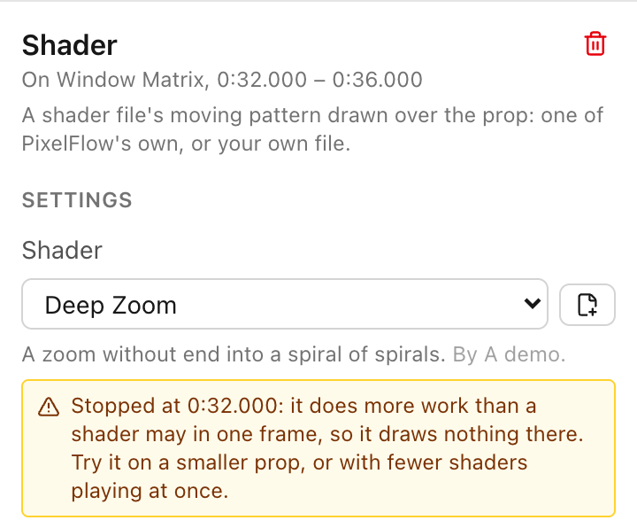

# Shaders

A Shader effect draws a moving picture worked out pixel by pixel by a small program: auroras,
lava lamps, rings on water, rainbows, and whatever else a shader file describes. This page says
what a shader file is, where PixelFlow keeps them, which ones it can run, and what it does with
one that misbehaves.

## What a shader file is

A shader file (`.fs`) is a short program in GLSL, the language graphics cards are programmed in,
with a header that names its inputs: the settings a person can change, like a speed, a number
of rings, a switch, a point, or a color. The format is the Interactive Shader Format (ISF), and
it is what xLights' Shader effect runs too. Collections of ISF shaders are shared online; each
file is its author's work, under whatever terms its author chose.

For each frame, the shader is asked the color of every pixel of the prop. It sees the prop's grid
as its picture: `RENDERSIZE` is the grid's columns and rows, and a pixel's place is the middle of
its cell, counted from the bottom left. On a matrix that is the matrix; on a tree it is the
strings side by side, so the picture wraps round the cone; on a group it is the whole layout,
and each prop shows the part of the picture that falls on it.

## PixelFlow's own shaders

PixelFlow comes with eight, written for it, so the effect is useful with no files of your own:

| Shader | What it draws | Best on |
|---|---|---|
| Aurora | Curtains of light swaying and drifting | Matrices, trees, the whole house |
| Prism | A rainbow flowing across, up, out from the middle, or round it | Anything: outlines and arches too |
| Lava Lamp | Soft blobs that drift and merge, clear between them | Matrices, trees; over another effect |
| Pond | Rings spreading from three drops and crossing | Matrices, trees |
| Nebula | Billowing clouds of color, clear where they're thin | Matrices, trees, the whole house |
| Stained Glass | Panes of colored glass that shift shape, with dark leading | Matrices, the whole house |
| Kaleidoscope | Mirrored wedges turning about the middle | Matrices, spinners |
| Tunnel | Checkered rings rushing past | Matrices |

Each has a handful of inputs (speed, size, colors, and the like). Their colors are their own
inputs, not the effect's palette.

## Using a shader

Drag **Shader** from the effect palette onto a row, or pick it in an effect's settings. The
settings panel shows:

- **Shader**: PixelFlow's own, then the shader files in your show. The button beside it adds a
  file from your computer.
- What the shader says of itself (its description and its author), from its header.
- A control for each input the shader declares: a slider with the shader's own range, a
  checkbox, a list, two sliders for a point (across and up), a color. An input you haven't
  touched stays as the shader's author set it. A number input can change over the effect, like
  any number setting.
- **Time speed**: how fast the shader's clock runs; 1 is its own pace, 0 holds it still, below 0
  runs it backwards. Under **More settings**, **Start ahead** starts the shader part-way into
  its own time.

Choosing another shader drops the inputs (and curves on them) that belonged to the old one.

## Where shader files live

A shader file you add, or one an xLights import finds, is copied into a `shaders` folder next to
your show file, and the effect names it `shaders/<name>.fs`. So the show folder can be moved,
backed up, or copied to another computer as a whole. While the show hasn't been saved there is no
such folder, and the file is used where it is until you save.

PixelFlow only reads shader files from the show's `shaders` folder and files you chose yourself
this session: a path written in a sequence file is not enough on its own, and a network path is
never followed. It reads only text files with a shader's extension (`.fs`, `.frag`, or `.glsl`)
of 256 KB or less.

PixelFlow never ships anyone else's shader files. If you use files from a shared collection, they
come with your show, under their authors' terms.

## Importing from xLights

An xLights sequence stores the full path its shader had on the computer it was made on. The
import looks for each file by name: where the sequence says, beside the sequence, in the folders
above it up to your xLights show folder, and in a `Shaders` folder in each of those (where
xLights keeps them). Each one found is copied into your show's `shaders` folder. The import
summary says which were copied, which weren't found, and which can't be run and why.

An effect whose shader is found and runs is a real Shader effect with the sequence's settings:
each input's value, the effect's speed and lead-in. It is expected to look the same as in xLights,
and the ones measured do (see [xLights import fidelity](fidelity.md)). Two things don't come
across, and the summary says so when a sequence has them: an input that changes over the effect
in xLights (a value curve) stays at its slider's value, and xLights' own Offset and Zoom for a
shader are kept but not applied. An effect whose shader isn't found, or can't be run, is shown
as a dim fill, as before; add the file to a `Shaders` folder beside the sequence and import
again, or choose a shader in the effect's settings.

## What is supported

PixelFlow runs shaders on the computer's processor with a shader engine of its own, so a shader
looks the same in the preview, on the lights, and in an export, on any computer, and the same
every time it plays.

It reads the GLSL that shaders for lights are written in: numbers, whole numbers, true/false,
vectors and square matrices of them, and arrays; functions (with `out` and `inout` arguments),
`if`, loops, `break`, `continue`, `return`, and `discard`; `#define` and `#if`; and the built-in
functions that work on numbers (`sin`, `mix`, `smoothstep`, `length`, `normalize`, and the rest).
`TIME`, `TIMEDELTA`, `FRAMEINDEX`, `RENDERSIZE`, `isf_FragNormCoord`, and `gl_FragCoord` are
given; `DATE` is always zero, so a frame never depends on the day it's drawn. Inputs can be
numbers, switches, choices, points, colors, and buttons (a button is never pressed).

A shader is **refused**, and says what it needs, when it uses:

- several passes (`PASSES`), or a picture kept from one frame to the next (persistent buffers);
- pictures: image inputs, its own picture files (`IMPORTED`), or `texture2D` and `IMG_PIXEL`;
- the music (audio and audio-FFT inputs);
- how a value changes from one pixel to the next (`dFdx`, `dFdy`, `fwidth`);
- structures, or recursion (a function that calls itself).

A file with a mistake in it is refused with the line the mistake is on. Either way the effect
draws nothing, and its settings panel says why.

## Limits

A shader file is a program from a file, and nothing in it is trusted: it can't read or write
anything but its own numbers, and what it may do is capped. The caps are counted, never timed, so
a shader that is stopped is stopped at the same place on every computer and every time.

- **Refused when the file is read:** a file over 256 KB, or over 200,000 words once its macros
  are expanded; nesting deeper than 128; over 200,000 instructions once every call is written
  out; over 4,096 numbers a pixel, or an array over 256; a loop nothing can ever leave; and a
  shader that does more work for every pixel than a pixel may (below).
- **A pixel's work:** each pixel may do 100,000 units of work a frame (an addition is one, a sine
  twelve, a power twenty-four). PixelFlow's own shaders do 100 to 2,000; the heaviest shader in
  the sequences PixelFlow was measured against does about 18,600.
- **A frame's work:** the Shader effects playing in one frame share 500 million units between
  them. The more pixels they cover, the less each pixel may do: a frame of shaders can't take
  more than about a seventh of a second, whatever the files say.
- A pixel that reaches its share is stopped and left dark. If the shader is stopped at any of the
  few places it is tried before a frame is drawn, the effect draws nothing at all that frame
  rather than a picture with holes, and its settings say "Stopped at …: it does more work than a
  shader may in one frame". Try it on a smaller prop, or with fewer shaders playing at once.

  

## The Assistant and shaders

The Assistant can list the shaders your show can use (with each one's description and inputs),
add a Shader effect, set its inputs and curves on them, and knows which props each suits. It
doesn't write or change shader files.
