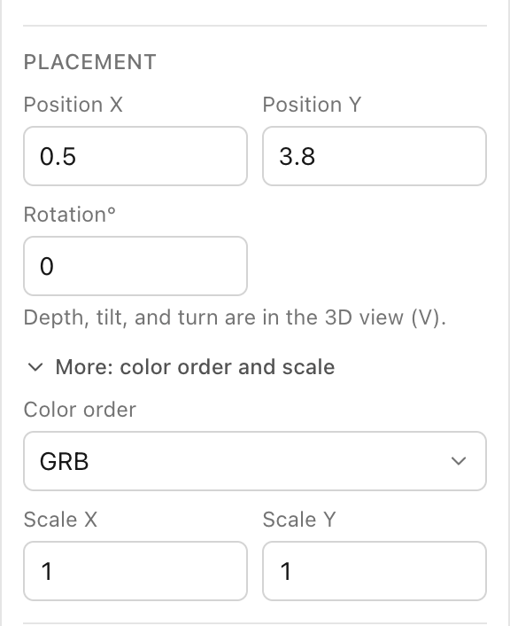
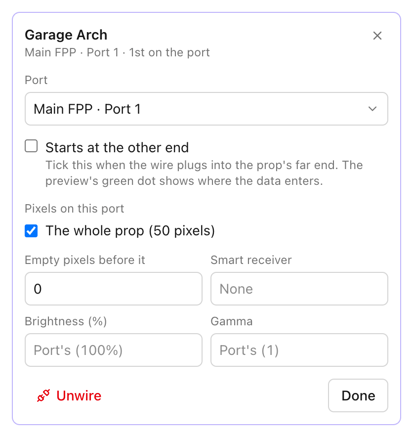
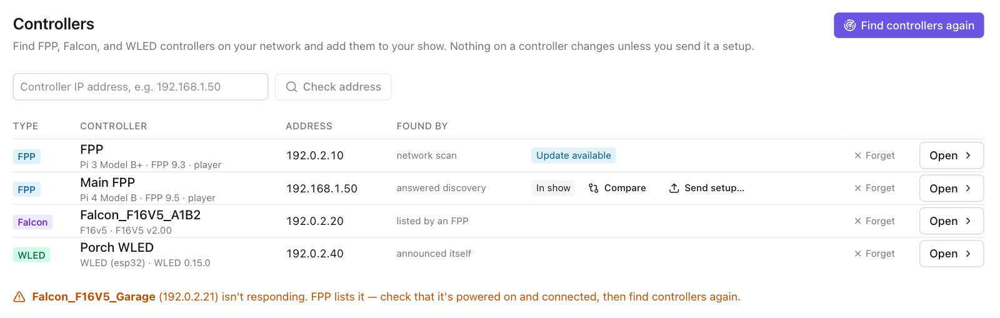
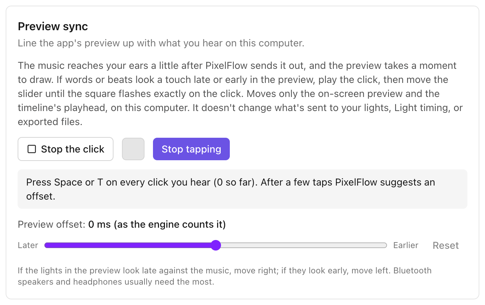

# Troubleshooting

Problems with lights, controllers, and the network, listed by what you see. Each section gives
the likely causes in the order to check them, and where to look in PixelFlow. New to PixelFlow?
Start with [Your first show](first-show.md).

PixelFlow can tell you a lot about what it sent. It cannot see your lights. Where the answer
depends on your hardware, this guide says "check your controller's own page" rather than guess.
That means the controller's web page, which you can open from PixelFlow: on **Controllers**, open
an FPP and choose **Open FPP's web page**.

- [Nothing lights](#nothing-lights)
- [Wrong colors (color order)](#wrong-colors-color-order)
- [Only some pixels light, or they stop partway](#only-some-pixels-light-or-they-stop-partway)
- [Props light in the wrong place or reversed](#props-light-in-the-wrong-place-or-reversed)
- [The controller is not found or "not answering"](#the-controller-is-not-found-or-not-answering)
- [FPP is playing and overriding PixelFlow](#fpp-is-playing-and-overriding-pixelflow)
- [Send to FPP fails](#send-to-fpp-fails)
- [Lights lag the music, or the preview looks late](#lights-lag-the-music-or-the-preview-looks-late)
- [Brightness is too high or low](#brightness-is-too-high-or-low)
- [A sequence import says effects look close or different](#a-sequence-import-says-effects-look-close-or-different)
- [Lyrics are wrong or in the wrong language](#lyrics-are-wrong-or-in-the-wrong-language)
- [The app is slow with a big show](#the-app-is-slow-with-a-big-show)
- [A file is "on a network share"](#a-file-is-on-a-network-share)

## A quick way to find the problem

Use the **Test** screen. It sends a plain pattern straight to one port, with no sequence in the
way.

1. Open **Test**.
2. Under **Target**, pick one port (they are listed as the controller's name, a dot, then "port"
   and a number).
3. Under **Pattern**, pick **Chase** and choose **Start**.
4. Compare what the lights do with what **Sends to** and the table below it say.

Under **Sends to**, each controller shows **Web page answering** or "Web page not answering — check it's
powered on and on the same network as this computer". **Web page answering** only means something
replied to a quick check of the controller's web page. It does not prove the light data arrives
(the screen says so too).

In the table, **State** tells you how sending is going:

- `ok`: this computer is sending. It doesn't prove the controller is receiving, because light
  data is sent without waiting for a reply.
- `degraded`: sends are failing. PixelFlow keeps retrying, waiting longer each time, up to five
  seconds. The reason is shown beside it.
- `unresolved`: the address couldn't be turned into a real address, so nothing is sent. Check the
  address you entered.

**Packets** counts what was sent. **Errors** counts sends that failed. The status bar at the foot
of the window also shows "Live output" with a **Stop** button while PixelFlow is sending.

## Nothing lights

Check these in order.

1. **PixelFlow isn't sending.** On **Test**, choose **Start** and look for "Sending …" with a
   frame rate and frame count. If the table of controllers is empty, nothing on that target is
   wired to a controller. The message says "Nothing on this target is wired to a controller yet,
   so there's nothing to send." Choose **Go to Wiring**.
2. **The address is wrong.** The status bar at the foot of the window counts problems ("1
   error", "2 warnings"). Choose it to see the list. Messages to look for include "The controller
   'name' has no IP address, so nothing is sent to it." and ones about an address PixelFlow
   can't use. Fix the address on **Wiring**: choose **Edit** on the controller's card.
3. **The controller isn't reachable.** Under **Sends to**, it shows "Web page not answering". See [The
   controller is not found or "not answering"](#the-controller-is-not-found-or-not-answering).
4. **The wrong protocol.** The controller's card on **Wiring** shows its protocol beside its
   address; to change it, choose **Edit** on the card and set **Protocol**: **DDP** or **sACN
   (E1.31)**. It must match what your controller listens for. Many controllers and FPP
   inputs need to be switched on for sACN. For DDP, PixelFlow sends to UDP port 4048. For sACN it
   sends to UDP port 5568. Check your controller's own page to see what it accepts.
5. **sACN universes don't match.** With sACN, the **Start universe** and **Channels per
   universe** on the controller's **Edit** form must match the controller. Open **More:
   universe size and multicast** to see the size. 510 channels fits exactly 170 RGB pixels per
   universe. Check your controller's own page for the universes it listens on.
6. **Something else is controlling the lights.** If an FPP is playing, it overrides PixelFlow. See
   [FPP is playing and overriding PixelFlow](#fpp-is-playing-and-overriding-pixelflow).
7. **Power and wiring.** If PixelFlow shows `ok` and the controller reports receiving data, the
   problem is on the controller side: power, the data wire, the port settings on the controller,
   or the string. Check your controller's own page. Swap in a string you know works.
8. **Your computer's network.** Make sure your computer is on the same network as the
   controller (see below).

## Wrong colors (color order)

The string expects red, green, and blue in a different order than PixelFlow sends them. For
example, red shows as green.

1. On **Test**, pick **Red / green / blue / white** as the **Pattern** and a port as the
   **Target**. Choose **Start**. Each color shows for one second, in that order (the line under
   the controls says so too). Write down what you see instead. The Test screen also has red,
   green, blue, and white buttons beside **Color** for the patterns that use one color.
2. On **Layout**, select the prop. In the **Properties** panel, open **More: color order and
   scale** and change **Color order**. (The Wiring and Test screens each have a note with a link
   to it. From Test, with one prop as the **Target**, **Open it on Layout** selects that prop and
   puts you on its **Color order**, while the test keeps running.) The choices are RGB, RBG,
   GRB, GBR, BRG, BGR, RGBW, and GRBW. Run the test again.

   
3. Common cases: a string that shows red as green and green as red is probably GRB. Choose the
   order that makes the test show red, then green, then blue.
4. Change it in **one place only**. If your controller's own page also has a color order for that
   string, it may swap the colors again. Check your controller's own page and leave one of them at
   its plain setting.
5. RGBW strings have a fourth, white channel. If an RGBW string looks wrong, check that the prop's
   **Color order** is RGBW or GRBW rather than a three-color order.

## Only some pixels light, or they stop partway

Likely causes, in order:

1. **The port is over its pixel limit.** On **Wiring**, each port shows a bar of pixels used. Read
   any message under the port. "N pixels more than this port can drive" means too many. Move a
   prop to another port. For a Falcon V4 or V5, PixelFlow's built-in limit is 1,024 pixels a
   port (704 if more than 32 ports are in use). It also warns that a port refreshes about 704
   pixels in time at 40 frames a second: "At 40 fps this port refreshes about 704 pixels in time;
   with N it will slow down." Move a prop to another port, or lower the show's frame rate. For
   other controllers, **Pixel limit** is empty until you set it. Choose the port's settings
   button and enter it. Check your controller's own page for the real limit.
2. **Null pixels or a gap in the wire.** If a string has dark stretches (a lead with no lights),
   set **Empty pixels before it** in the prop's slot settings on **Wiring**. If the count is wrong,
   later pixels appear shifted. Also check that **From pixel** and **To pixel** cover the whole
   prop. The checkbox "The whole prop (N pixels)" should be ticked if the prop sits entirely on
   this port.

   
3. **The pixel count is wrong.** On **Layout**, select the prop and check its pixel count in
   **Properties**. If the count is higher than the real string, the last pixels "stop" short; if
   it is lower, some real pixels stay dark.
4. **Power.** Pixels that fade to white or flicker, or go dim towards the end of a long string, are
   usually a power problem. Add power at the far end of the string. PixelFlow can't see this.
   Check your supply.
5. **A bad pixel.** If everything after one pixel is dark, that pixel or its connection may be
   faulty. Use **Pixel walk** on **Test** to light one pixel at a time and find where it stops.
6. **The controller's own port settings.** The controller has its own pixel count per port. If it
   is lower than your string, the extra pixels never light. Check your controller's own page. To
   read a controller's current setup into PixelFlow, use **Compare** on its row on
   **Controllers** (**Compare with this controller** on its own page).
7. **A wiring problem listed on Wiring.** A red box headed "N things to fix" lists problems.
   Examples: a prop wired more than once, a slot that uses more pixels than the prop has, or two
   ports with the same number.

## Props light in the wrong place or reversed

1. **Reversed prop.** The string plugs into the far end of the prop. On **Wiring**, open that prop's
   slot settings and tick **Starts at the other end**. The preview's green dot shows where the data
   enters. Check that the dot is at the end where the wire really plugs in.
2. **Wrong order on the port.** The order of props on a port is the order the wire runs. Drag a
   prop to a new place in the list, or use Alt with the arrow keys (Option on a Mac) on the
   prop's name. A **Chase** on **Test** moves along the props in wiring order.
3. **Wrong port.** Use **Identify (blink)** on **Test** with a port as the **Target**. The lights
   on that port blink white twice a second. If a different prop blinks, move the prop to the
   correct port, or renumber the port: choose the port's settings button and set **Port number** to
   the number printed on the controller.
4. **A prop is in the wrong place on screen but lights correctly.** That is a **Layout** issue.
   Move the prop on the canvas. The lights follow the wiring, not the picture.
5. **Pixels are in the wrong place inside a prop.** The shape's pixel layout might not match the
   real prop. **Camera mapping** on **Test** finds where each pixel really is by filming the
   lights.
6. **Imported from xLights.** Read the import notes for the prop. Some wiring details are
   approximated. See [A sequence import says effects look close or
   different](#a-sequence-import-says-effects-look-close-or-different).

## The controller is not found or "not answering"

PixelFlow looks for controllers on your network. It cannot find ones it can't reach.

1. **Power and cable.** Check the controller is on and its network light is lit. This is the most
   common cause.
2. **The same network.** Your computer and the controller must be on the same network (the same
   subnet). If your computer is on Wi-Fi and the controller is on a separate network or a guest
   network, discovery won't see it. A controller at `192.168.1.50` is generally reachable from a
   computer at `192.168.1.20`, not from one at `192.168.2.20`. Check your router.
3. **Check the address directly.** On **Controllers**, type the address in the box that says
   "Controller IP address, e.g. 192.168.1.50" and choose **Check address**. If PixelFlow says "No
   controller answered at …", check the address and that the controller is on.
4. **Your computer's firewall or privacy settings.** The empty list says: "If your computer asks
   whether PixelFlow may accept incoming connections, allow it so controllers can answer." On a
   Mac, also open System Settings, then Privacy & Security, then Local Network, and make sure
   PixelFlow is allowed. Without it, PixelFlow can't talk to controllers on your network. Check the
   wording on your version of macOS. On Windows, allow PixelFlow when the firewall asks.
5. **A password.** A controller that asks for a password can't be read. PixelFlow lists it as
   "asks for a password, so PixelFlow can't read it". For an FPP, turn off its UI and API password
   in FPP's settings, then choose **Find controllers again**.
6. **An FPP lists a controller that doesn't answer.** A message like "*name* (address) isn't
   responding. *FPP* lists it" means the FPP sends to it but it isn't answering. Check its power
   and network cable, then choose **Find controllers again**.

   
7. **Use the host name.** A host name such as `fpp.local` can work where scanning doesn't. Type
   it in the address box.
8. **IPv6.** PixelFlow sends to controllers over IPv4 only. An address that is IPv6 produces an
   error that says so.

On **Test**, the "Web page not answering" note under **Sends to** has the same meaning. Choose **Check
again** after you fix something.

## FPP is playing and overriding PixelFlow

If an FPP is playing a show at the same time, the FPP's output wins on the same controllers.
PixelFlow's lights then look wrong or flicker.

1. On **Play**, an amber bar says "*name* is playing …. While it plays, it overrides PixelFlow on
   the same controllers." Choose **Stop FPP**.
2. On **Controllers**, open the FPP. **Now playing** shows what it is playing. Choose **Stop now**
   to stop at once, or **Stop after this** to let the current sequence finish.

   
3. If the FPP's scheduler starts a playlist at a set time, it can start again. Check its
   schedule on the FPP's own page.
4. When you **Send setup** and the FPP is playing, the dialog warns: "This FPP is playing … Its
   lights may flicker or go dark while the new setup is saved." See [Hardware
   acceptance: safety notes](hardware-acceptance.md#safety-notes).

## Send to FPP fails

The **Send to FPP** window shows the problem in red. The words after "FPP said:" under **Details**
are the FPP's own message.

1. **"Couldn't reach the FPP at …"** Check the FPP is on and on the same network as this computer.
   See [The controller is not found or "not
   answering"](#the-controller-is-not-found-or-not-answering).
2. **"The FPP at … stopped answering during the upload."** The network dropped partway. Check the
   FPP's network connection, then choose **Try again**. A weak Wi-Fi link is a common cause.
3. **Storage is full.** The window says "There isn't room on the FPP: this needs … and it has …
   free", or "The FPP's storage is full". Delete old sequences or music on the FPP, using its File
   Manager, then try again. The window shows how much room the FPP has: "… has … free."
4. **"The FPP couldn't store …"** The FPP refused the file. Read the text after "FPP said:".
5. **Files left behind.** If a send fails, PixelFlow tries to tidy up. If it can't, the message
   names files that "may be left in the FPP's File Manager, under Uploads". Delete them there.
6. **A sequence or music with the same name.** The window asks what to do: **Replace it**, **Keep
   both**, or **Use the one already on the FPP**. A replace changes any FPP playlist that plays
   that file.
7. **"The channels may not match … outputs".** The window compares the sequence's channels with
   the FPP's channel outputs. Warnings include "Lights past channel N will stay dark" and
   "Channels past N won't reach any lights." You can still send. Fix them by making your show's
   controllers match what the FPP sends to. On **Controllers**, open the FPP and use **Set up my
   show from this FPP**.
8. **A password.** If the FPP has a UI and API password, PixelFlow can't talk to it. Turn it off in
   FPP's settings.
9. **Playback fails afterward.** After a successful send, choose **Play it now on the FPP**. If the
   FPP is busy, the window asks "Stop … and play this now?". On **Controllers**, the FPP page's
   **Health** section lists warnings the FPP reports.

Stop a send with **Cancel**. Nothing on the FPP changes if you cancel before the files are
moved into place. Once the window says "Moving the files into place. This can't be cancelled
now.", wait.

## Lights lag the music, or the preview looks late

There are three separate timings. Fix the one that matches what you see.

1. **The preview looks late, but the real lights are fine.** Your computer takes time to play
   sound and draw the picture. Open **Settings**, find **Preview sync**, choose **Play the click**,
   and slide **Preview offset** until the square flashes exactly on the click. Or, while the click
   plays, choose **Tap along** and press Space or T on every click you hear. PixelFlow suggests
   an offset, which you accept with the **Use** button. **Preview sync** moves only the preview
   and the timeline's playhead on this computer. It does not change the lights, **Light timing**,
   **Send to FPP**, or exports.
   Bluetooth speakers and headphones usually need the most.

   
2. **The real lights are early or late against the music from PixelFlow's Play screen.** On **Play**,
   choose **Playlist**. Under **Music**, find **Light timing** ("Move the lights earlier or later against the music"). Use the **−50 ms**, **−10 ms**,
   **+10 ms**, and **+50 ms** buttons to move the lights earlier or later. A plus value moves
   the lights earlier. **Reset** puts it back. This applies to one rendered (`.fseq`) sequence at a time, in
   the preview and on your controllers when it plays from PixelFlow. Settings points here: "Light
   timing for each sequence is set beside it on the Play screen (Playlist, then Music)."

   

3. **The lights are wrong on the FPP itself.** After **Send to FPP**, the FPP plays the file
   and its music on its own. **Light timing** is not saved into the exported file or **Send to
   FPP** (the app only applies it while it plays), so it doesn't carry over. Check the timing on the FPP. If it is off, it may come
   from the FPP's audio output (a USB sound card or HDMI adds delay). Check your controller's
   own page.
4. **The effects are off against the beats.** Use **Detect beats** and **Snap** on
   **Sequence**, or drag effects to the marks by hand.

## Brightness is too high or low

1. **Brightness at the prop's slot.** On **Wiring**, open the prop's slot settings. **Brightness
   (%)** and **Gamma** are set there, from 0 to 100. If empty, the port's value applies (shown as
   "Port's (N%)"). A gamma of 2.2 suits most pixels. A gamma of 1 leaves colors as they are.
2. **Set in two places.** Brightness and gamma can be set in PixelFlow and on the controller.
   If both reduce the brightness, the lights are dimmer than either setting suggests. Pick one
   place. PixelFlow's live output and its exported `.fseq` file already apply a port's brightness,
   gamma, color order, and reverse. Check your controller's own page so it doesn't apply them
   again.
3. **Glow is a preview look only.** The **Glow** control changes how the on-screen preview and
   exported videos look. It does not change the lights.
4. **Colors look washed out or too harsh in the preview.** Adjust **Glow**: none for bare bulbs,
   more for lights behind diffusers.
5. **Power.** Lights that look dim or yellow when many pixels are white can be short of power.
   Check your supply.

## A sequence import says effects look close or different

Importing an xLights sequence translates each effect to the closest PixelFlow effect. The report
says how much of the sequence *comes across the same*, how much *looks close* or *looks
different*, and how much has *no PixelFlow effect yet*. Under that it lists the effects that
differ, with what you would notice.

1. **Close isn't broken.** It means the same idea with a difference you could notice, such as a
   shape or a speed. The report says what.
2. **Preview it.** Play the sequence and compare it to xLights. Many differences are small.
3. **No PixelFlow effect yet** means a dim stand-in is shown where PixelFlow has no match.
4. **Prop shapes.** For a show import, notes say which props were approximated, such as a model
   whose shape could only be estimated. Check those props on **Layout**.
5. **How close is it?** See [xLights import fidelity](fidelity.md) for how the look of an
   import is measured, and what is known to differ.
6. **Many notes about the same effect.** One kind of effect is often the cause. Replace it by hand,
   or ask the assistant.
7. **Vendor sequences.** If many effects are missing, check the mapping in the "Map … onto your
   props" window. A model that is **Not mapped** brings none of its effects.

## Lyrics are wrong or in the wrong language

**Find lyrics** looks up published lyrics on LRCLIB, then times each word against the song.

1. **Wrong song.** Under the lyrics source line, choose **Wrong song?**. It lists other lyrics that
   were found. Choose the right one. Or paste the lyrics into the box ("plain lines, or LRC with
   [mm:ss] times") and choose **Use pasted lyrics**.
2. **Look it up again.** Choose **Find again** to look up and listen again, without what is kept
   for this song. Shift-click **Find lyrics** does the same.
3. **Wrong language.** Open **Settings**, and in the **AI** section choose **AI settings…**.
   Under **Lyrics**, set **Lyrics language**. It is what **Find lyrics**
   expects when the published lyrics and tags don't say.
4. **On-device alignment** is for songs sung in English. It needs a one-time model download that
   asks first.
5. **"Find lyrics needs a song: choose this sequence's music first."** Set the sequence's music.
6. **"Finding lyrics needs the assistant: set it up in Settings → AI."** Add an AI key first.
7. **Audio is sent to OpenAI only if you agree.** See [what stays on your
   computer](privacy-and-data-flow.md#lyrics).

## The app is slow with a big show

PixelFlow is built to handle large shows. See [Scale benchmark](benchmarks.md) for what the
engine can do on a test machine. Those numbers are for the engine only, not your computer's
screen. Things to try, in order:

1. **Use the 2D view** while you edit. Press V on **Layout**, or choose **2D** on the sequence
   preview. The 3D view draws more.
2. **Turn Glow down** to none, using the **Glow** control beside the **2D** and **3D** buttons. It is a preview-only effect, so turning it off can't change the lights.
3. **Close the pop-out preview** if you don't need it: close its window, or choose **Bring the
   preview back** where the preview was.
4. **Turn off Show on my lights** while you edit. Playing then sends only to the on-screen preview.
5. **Make the preview smaller.** Drag the divider, or choose **Bigger preview** again to give
   the timeline its room back.
6. **Show only the row you are working on.** Tick **Selected row only** above the sequence
   preview.
7. **Close other apps,** especially ones that use a lot of the graphics chip.
8. **A port that is too full** is not an app problem. On **Wiring**, a message such as "this port
   refreshes about 704 pixels in time" is about the controller's limit, not your computer.
9. **Still slow?** Note the pixel count (the status bar at the foot of the window shows props,
   pixels, and controllers) and your computer's model, and open an issue at the project's
   repository.

## A file is "on a network share"

A show or a sequence can name its music, photo, or pictures by a place on a network share, such
as `\\server\share\Music\Song.mp3`. PixelFlow lists such a file with the missing ones and says,
for example: "Song.mp3 is on a network share (\\server\share). PixelFlow opens files from a
network folder only after you choose a file in that folder yourself."

Nothing is wrong with the file. PixelFlow has not looked for it, because on Windows even looking
at a network place signs in to that server, and a show from someone else could name a server
that isn't yours. See [A note on shows from other people](privacy-and-data-flow.md#a-note-on-shows-from-other-people).

1. **If the share is yours,** choose **Locate…** beside the file and pick it. PixelFlow then
   reads everything else in that folder (and the folders inside it) until you quit, so other
   files there are found when you choose **Find again** on them.
2. **To never be asked,** give the share a drive letter in Windows (Map network drive) and
   choose the files from that drive, or keep the files in the show's own folder.
3. **If you don't know the server,** don't choose anything on it. Pick your own copy of the
   file with **Locate…** instead.
